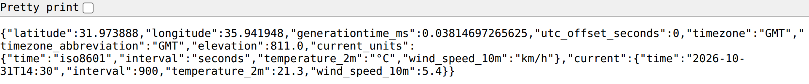
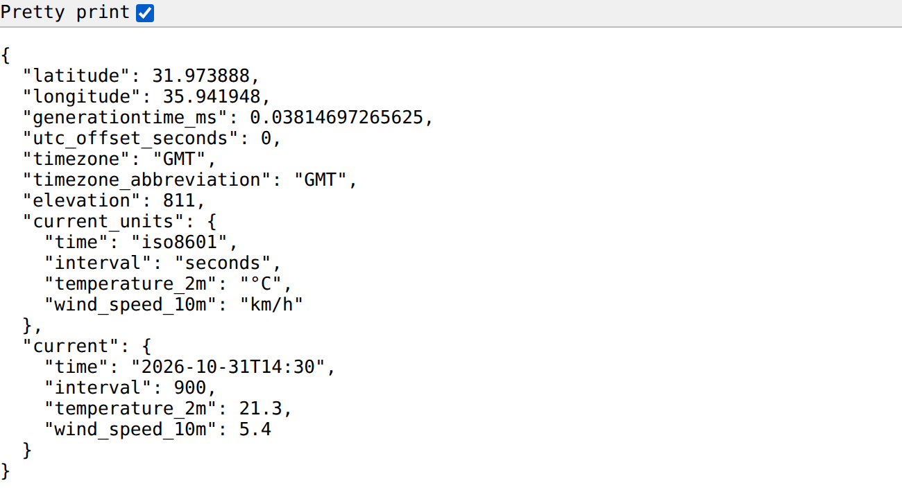
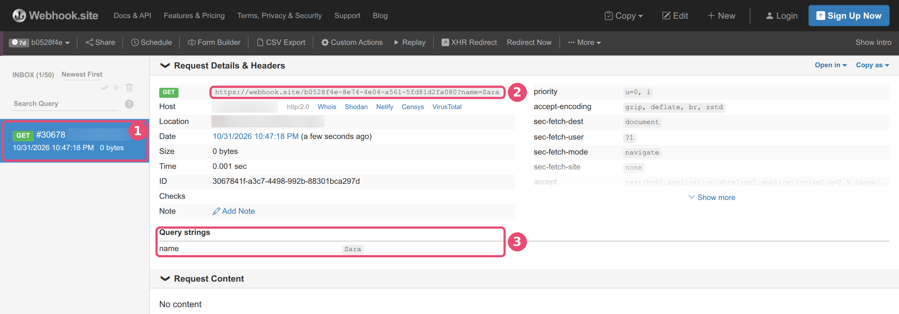
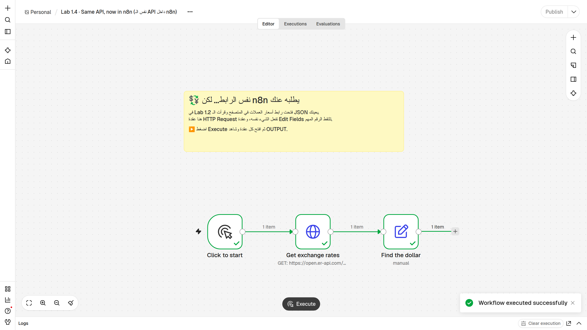
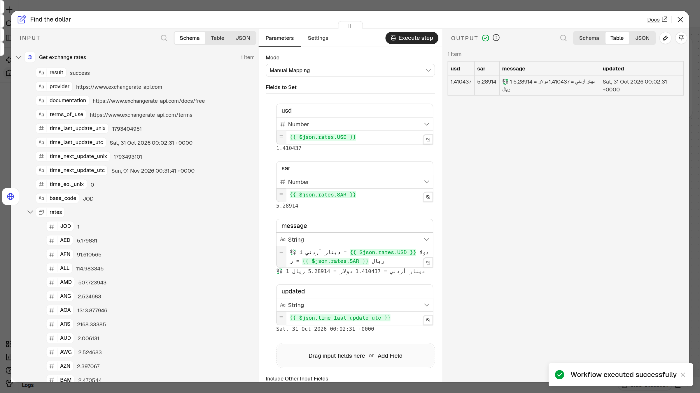

# 🧪 Lab 1 · فكّر كمصمّم أتمتة — Think Like an Automator

> **الحصة 1 · n8n من الصفر** — ثلاثة تمارين **بدون n8n** (متصفح وورقة فقط): نصمّم أتمتة على الورق، ثم نكلّم API من المتصفح، ثم نضغط جرس Webhook حقيقي.
> **Class 1 · n8n from zero** — three exercises, browser and paper only: design an automation on paper, talk to an API from your browser, then ring a real webhook doorbell.
> ⭐ **إضافي / Bonus:** تمرين 1.4 داخل n8n عندما يصبح عندك حساب — نفس رابط الـ API، لكن n8n يطلبه عنك.

| التمرين / Lab | ماذا تحتاج / You need | الوقت / Time |
|---|---|---|
| 1.1 · صمّم أتمتتك الأولى — Design your first automation | ورقة وقلم (أو الـ handout ص 3) | ~12 دقيقة |
| 1.2 · كلّم API من متصفحك — Talk to an API from your browser | متصفح | ~13 دقيقة |
| 1.3 · اضغط جرس الباب بنفسك — Ring a real webhook doorbell | متصفح (+ هاتفك، اختياري) | ~10 دقائق |
| ⭐ 1.4 · إضافي: نفس الـ API داخل n8n — Bonus: the same API in n8n (`api-in-n8n.json`) | حساب n8n Cloud (بعد إنشائه) | ~10 دقائق · في البيت أو أول الحصة 2 |

---

## 🎯 الهدف / Goal

بنهاية هذا التمرين ستكون قادراً على:

1. **تحويل مهمة متكررة** من حياتك إلى تصميم أتمتة: **المُشغِّل Trigger** ← **الخطوات Steps** ← **النتيجة Result**، وحساب الدقائق التي توفّرها أسبوعياً.
2. **إرسال طلب GET** («أرني…») إلى **API** حقيقي من شريط المتصفح، وقراءة الرد بصيغة **JSON** (الاستمارة المعبّأة): تجد قيمة، وتعرف هل هي نص أم رقم أم قائمة.
3. **صنع جرس باب Webhook** خاص بك على الإنترنت، ورنّه، ورؤية الرنّة تصل **فوراً** — ثم التمييز بين **Webhook** (الجرس) و **Polling** (تفقّد الباب كل 5 دقائق).

*By the end you can turn a repeated task into Trigger → Steps → Result, call a free API from your browser and read its JSON, and ring a real webhook URL and watch it arrive instantly.*

---

## ✅ قبل أن تبدأ / Before you start

- [ ] لابتوب (الأفضل) أو هاتف، متصل بالإنترنت.
- [ ] متصفح **Firefox** (الأفضل: يرتّب الـ JSON وحده) أو **Chrome**.
- [ ] الـ handout المطبوع (ص 3 و 4)، أو ورقة وقلم.
- [ ] **لا تحتاج** أي حساب ولا أي مفتاح API (بطاقة عضوية). كل المواقع اليوم مجانية ومفتوحة.
- [ ] (اختياري لـ 1.3) هاتفك، لترنّ الجرس من جهاز آخر.

> 💡 **كلمات ستراها:** API = النادل 🤵 (ينقل طلبك للمطبخ ويرجع بالرد) · JSON = استمارة معبّأة 📝 · key = اسم الحقل · value = ما كُتب فيه · URL = الرابط في شريط العنوان · Webhook = جرس الباب 🔔 · Polling = تفقّد الباب كل 5 دقائق 🚶.

---

## ✏️ Lab 1.1 · صمّم أتمتتك الأولى — Design your first automation

كل أتمتة مثل **وصفة طبخ** لها 3 أجزاء: **⚡ المُشغِّل Trigger** (متى نبدأ؟) ← **⚙️ الخطوات Steps** (ماذا نفعل، بالترتيب؟) ← **🎯 النتيجة Result** (ماذا نحصل في النهاية؟).
المُشغِّل نوعان: **حدث** («عندما يصل…» = جرس الباب 🔔) أو **وقت** («كل يوم الساعة…» = المنبّه ⏰).

**📋 مثالان محلولان / Two worked examples** (الأرقام توضيحية فقط):

| ⚡ المُشغِّل Trigger | ⚙️ الخطوات Steps | 🎯 النتيجة Result | 📱 التطبيقات Apps | ⏱ دقائق/أسبوع Minutes saved |
|---|---|---|---|---|
| **مثال 1 · متجر صغير:** عندما يرسل زبون طلباً عبر نموذج الطلب 🔔 | 1) انسخ الاسم والهاتف والطلب إلى جدول 2) أرسل رسالة تأكيد للزبون 3) نبّه مندوب التوصيل | طلب مسجّل، زبون مطمئن، مندوب يعرف | Google Forms، Google Sheets، Telegram | 5 د × 8 طلبات × 6 أيام = **240 د** (4 ساعات) |
| **مثال 2 · تقرير يومي:** كل يوم الساعة 8:00 صباحاً ⏰ | 1) اجلب مبيعات الأمس من الجدول 2) احسب المجموع 3) أرسله بالإيميل للمدير | تقرير يصل المدير قبل الدوام | Google Sheets، Gmail | 20 د × 5 أيام = **100 د** |

هكذا يبدو المثال 1 لو رسمناه كما في n8n، من اليسار إلى اليمين (أسماء المربعات بالإنجليزية كما ستراها في n8n):

```
[New order] ──▶ [Add row to sheet] ──▶ [Confirm to customer] ──▶ [Tell the driver]
```

المربع الأول هو **المُشغِّل** ⚡، والثلاثة بعده هي **الخطوات** ⚙️ بالترتيب.

**✍️ دورك / Your turn** — هذه ورقتك (نفس الجدول مطبوع في الـ handout ص 3):

| ⚡ المُشغِّل Trigger | ⚙️ الخطوات Steps | 🎯 النتيجة Result | 📱 التطبيقات Apps | ⏱ دقائق/أسبوع Minutes saved |
|---|---|---|---|---|
| **مهمتي 1:** | | | | |
| **مهمتي 2:** | | | | |

### 🪜 الخطوات / Steps

1. في هامش الورقة اكتب **3 مهام** تكرّرها كل أسبوع بنفس الطريقة (في العمل، الدراسة، أو البيت).
   👀 *قائمة من 3 أسطر، مثل «نسخ الطلبات إلى Excel» أو «الرد على نفس السؤال في واتساب».*
2. ضع دائرة حول **مهمتين** منها: الأكثر تكراراً أو الأكثر إزعاجاً.
   👀 *مهمتان عليهما دائرة.*
3. في سطر **مهمتي 1**، عمود **⚡ المُشغِّل**: اكتب متى تبدأ المهمة. ابدأ الجملة بـ «عندما…» (حدث) أو «كل…» (وقت).
   👀 *جملة مثل «عندما يصل إيميل فيه فاتورة» أو «كل أحد الساعة 9:00».*
4. في عمود **⚙️ الخطوات**: اكتب الخطوات مرقّمة، وكل خطوة = **فعل واحد** (انسخ، أرسل، احفظ، احسب).
   👀 *2 إلى 4 أسطر قصيرة مرقّمة: 1) … 2) … 3) …*
5. في عمود **🎯 النتيجة**: اكتب ماذا تحصل في النهاية.
   👀 *جملة واحدة، مثل «كل الفواتير في جدول واحد».*
6. في عمود **📱 التطبيقات**: اكتب أسماء التطبيقات المستخدمة (Gmail؟ Google Sheets؟ WhatsApp؟ Telegram؟ Excel؟).
   👀 *اسم إلى 3 أسماء.*
7. في عمود **⏱ دقائق/أسبوع**: احسب **دقائق المهمة × مرات في اليوم × أيام في الأسبوع**.
   👀 *رقم بالدقائق، مثل 10 × 3 × 5 = **150 د**.*
8. كرّر الخطوات 3 إلى 7 لسطر **مهمتي 2**.
   👀 *سطران كاملان، كل سطر فيه 5 خانات مملوءة.*

### 🎉 النتيجة المتوقعة / Expected result

ورقة فيها **مهمتان مصمّمتان بالكامل**. افحص كل سطر بثلاثة أسئلة:

| السؤال / Check | ✔️ |
|---|:---:|
| هل يبدأ المُشغِّل بـ «عندما…» أو «كل…»؟ | ☐ |
| هل كل خطوة **فعل واحد** بالترتيب؟ | ☐ |
| هل عندك رقم بالدقائق في آخر السطر؟ | ☐ |

📌 احتفظ بالورقة! سنختار منها أمثلة نبنيها في n8n لاحقاً في الدورة.

---

## 🌤️ Lab 1.2 · كلّم API من متصفحك — Talk to an API from your browser

عندما تكتب رابطاً في المتصفح وتضغط Enter، فأنت **الزبون (Client)** ترسل **طلب GET** («أرني…») إلى **النادل (API)**. النادل يذهب إلى **المطبخ (Server)** ويرجع لك بـ **استمارة معبّأة (JSON)**.
القيم **حيّة وتتغيّر** (الطقس مثلاً)، فاكتب ما تراه أنت. الأمثلة أدناه حقيقية من يوم كتابة المختبر.

**👓 اجعل الـ JSON سهل القراءة / Make JSON readable**

- في **Firefox**: يرتّب الـ JSON ويلوّنه وحده. إذا رأيته سطراً واحداً، اضغط تبويب **JSON** أو زر **Pretty Print** في أعلى الصفحة.
- في **Chrome**: يعرض الرد سطراً طويلاً واحداً. ضع علامة ✔️ في خانة **Pretty print** أعلى يسار الصفحة.

| بدون Pretty print (سطر طويل) | مع Pretty print (مرتّب) |
|---|---|
|  |  |

### 🪜 الخطوات / Steps

**أ) طقس عمّان الآن — open-meteo 🌤️** (الجميع يبدأ هنا)

1. افتح تبويباً جديداً في المتصفح (`Ctrl+T`، وعلى Mac: `Cmd+T`).
   👀 *تبويب فارغ، وشريط العنوان في الأعلى.*
2. انسخ الرابط الذي في المربع التالي **كاملاً**، والصقه في شريط العنوان، ثم اضغط `Enter`:

```text
https://api.open-meteo.com/v1/forecast?latitude=31.95&longitude=35.93&current=temperature_2m,wind_speed_10m
```

   👀 *نص يبدأ بـ `{"latitude":31.97…` (في Firefox تراه مرتّباً ملوّناً مباشرة).*

3. في Chrome فقط: ضع علامة ✔️ في خانة **Pretty print** أعلى يسار الصفحة.
   👀 *كل سطر فيه: اسم حقل بين `" "` ثم `:` ثم قيمة — مثل صورة «مع Pretty print» أعلاه.*
4. ابحث عن الكلمة `"current"` (اضغط `Ctrl+F` واكتب `current`).
   👀 *استمارة صغيرة داخل الاستمارة الكبيرة، تشبه هذا (مختصر — ستجد أيضاً مفاتيح مثل `interval`، تجاهلها):*

```json
{
  "timezone": "GMT",
  "current_units": { "temperature_2m": "°C", "wind_speed_10m": "km/h" },
  "current": {
    "time": "2026-10-31T14:15",
    "temperature_2m": 21.7,
    "wind_speed_10m": 4.3
  }
}
```

5. 🔎 **جد القيمة / Find the value** — أجب على الورقة:
    - كم درجة الحرارة الآن؟ ………… أي key يحملها؟ ………… داخل أي استمارة؟ …………
    - ما وحدة القياس؟ (ابحث في `current_units`) …………
    - هل الحرارة **نص** أم **رقم**؟ كيف عرفت؟ …………

**ب) روابط بديلة / Backup URLs** (إذا لم يفتح رابط الطقس، أو انتهيت مبكراً)

6. افتح **مستخدماً تجريبياً** من JSONPlaceholder (بيانات وهمية مخصّصة للتدريب) — انسخ هذا الرابط إلى شريط العنوان واضغط `Enter`:

```text
https://jsonplaceholder.typicode.com/users/1
```

   👀 *استمارة مرتّبة جاهزة لشخص اسمه `"Leanne Graham"`، وفيها استمارتان صغيرتان: `address` (العنوان) و `company` (الشركة).*
   🔎 ما قيمة `email`؟ ………… · ما قيمة `city`، وداخل أي استمارة هي؟ ………… · ما اسم الشركة (`company` ← `name`)؟ …………

7. افتح **سعر صرف الدينار** من ExchangeRate-API بنفس الطريقة:

```text
https://open.er-api.com/v6/latest/JOD
```

   👀 *في البداية `"result": "success"` و `"base_code": "JOD"`، ثم قائمة طويلة اسمها `rates` فيها أكثر من 150 عملة.*
   🔎 كم دولاراً أمريكياً يساوي دينار واحد؟ (`Ctrl+F` ← `USD`) ………… · وكم ريالاً سعودياً (`SAR`)؟ ………… · متى آخر تحديث (`time_last_update_utc`)؟ …………

**ج) إضافي اختياري / Optional extras: agify و nationalize**

> ⚠️ **حدّ صغير جداً:** هذان الموقعان يسمحان بحوالي **10 طلبات في اليوم لكل شبكة إنترنت** (مشتركة بين الموقعين). في قاعة فيها الجميع على نفس الـ Wi-Fi ستنتهي في دقيقة، وسيظهر `{"error":"Request limit reached"}` — هذا **ليس خطأك** (رمز **429**: «طلبت كثيراً اليوم»). جرّبهما من بيانات الهاتف (4G/5G) أو في البيت.

8. افتح **تخمين العمر من الاسم**:

```text
https://api.agify.io/?name=sara
```

   👀 *سطر واحد: `{"count":263640,"name":"sara","age":38}`*
   🔎 ما العمر المتوقّع، وأي key يحمله؟ ………… · ماذا تظن أن `count` يعني؟ …………

9. افتح **تخمين البلد من الاسم**:

```text
https://api.nationalize.io/?name=omar
```

   👀 *قائمة اسمها `country` بين `[ ]`، كل عنصر فيها استمارة صغيرة (مختصر):*

```json
{
  "count": 913606,
  "name": "omar",
  "country": [
    { "country_id": "EG", "probability": 0.127113 },
    { "country_id": "MA", "probability": 0.126303 },
    { "country_id": "MX", "probability": 0.064575 },
    { "country_id": "DZ", "probability": 0.059505 },
    { "country_id": "JO", "probability": 0.040565 }
  ]
}
```

   🔎 كم دولة في القائمة؟ ………… · هل يظهر الأردن `JO`، وما احتماله؟ ………… · هل `country` نص أم رقم أم **قائمة**؟ ………… *(تلميح: `0.127` تعني تقريباً 12.7٪.)*

### 🎉 النتيجة المتوقعة / Expected result

أجبت على أسئلة **أ** (الطقس)، وعلى رابط واحد على الأقل من **ب** أو **ج**. مثال لما وجدناه يوم كتابة المختبر:

| الرابط / URL | أين القيمة؟ / Where | مثال / Example |
|---|---|---|
| الطقس (open-meteo) | `current` ← `temperature_2m` | `21.7` (والوحدة `°C` في `current_units`) |
| مستخدم تجريبي (JSONPlaceholder) | `address` ← `city` | `"Gwenborough"` |
| سعر الصرف (ExchangeRate-API) | `rates` ← `USD` | `1.41` تقريباً |

⚠️ **الأرقام عندك ستكون مختلفة** — إنها بيانات حيّة! هذا طبيعي وليس خطأ.

---

## 🔔 Lab 1.3 · اضغط جرس الباب بنفسك — Ring a real webhook doorbell

في 1.2 كنت **أنت** من يسأل (تفتح الرابط = تطلب من النادل). الآن العكس: سنصنع **جرس باب** خاص بك على الإنترنت، ونرنّه، ونرى الرنّة تصل **فوراً** بدون أن نسأل.
نستخدم موقع **webhook.site**: مجاني، و**بدون حساب**.

| في البيت 🏠 | على webhook.site 🌐 |
|---|---|
| بيتك، تجلس فيه وتنتظر | صفحة webhook.site مفتوحة في التبويب الأول |
| عنوان جرس بابك | الرابط الخاص بك **Your unique URL** |
| زائر يضغط الجرس، ومعه ورقة عليها اسمه | تفتح الرابط في تبويب آخر وفي آخره `?name=Sara` |
| «دينغ دونغ!» 🔔 ترى من على الباب | سطر جديد يظهر في **INBOX**، واسم الزائر تحت **Query strings** |

### 🪜 الخطوات / Steps

1. في تبويب جديد افتح **https://webhook.site**
   👀 *صفحة عنوانها **Your unique URL**، وتحته رابط طويل يبدأ بـ `https://webhook.site/` ثم حروف وأرقام (مثل `https://webhook.site/b0528f4e-8e74-…`). على اليسار عمود **INBOX (0/50)** ومكتوب فيه **Waiting for the first request**.*
   > 🔔 هذا الرابط هو **جرس بابك**. لا أحد غيرك عنده نفس الرابط. تجاهل زر **Sign Up**، لا نحتاج حساباً.
2. انسخ الرابط: اضغط أيقونة النسخ 📋 بجانبه، أو ظلّله كله بالفأرة واضغط `Ctrl+C`.
   👀 *الرابط الآن محفوظ (في الحافظة) وجاهز للّصق.*
3. افتح تبويباً **ثانياً** (`Ctrl+T`) والصق الرابط في شريط العنوان (`Ctrl+V`). **لا تضغط Enter بعد.**
   👀 *الرابط الطويل في شريط العنوان.*
4. أضف في آخر الرابط مباشرة (بدون مسافة): `?name=` ثم اسمك **بحروف إنجليزية**.
   👀 *العنوان صار مثل: `https://webhook.site/b0528f4e-…-5fd81d2fa080?name=Sara`*
5. اضغط `Enter`.
   👀 *صفحة شبه فارغة فيها جملة واحدة: `This URL has no default content configured.` هذا رد الجرس: «وصلت الرنّة» (رمز **200** ✅).*
6. ارجع إلى التبويب **الأول** (webhook.site). **لا تضغط تحديث.**
   👀 *خلال ثانية أو اثنتين ظهر على اليسار سطر أزرق جديد يبدأ بـ **GET** ورقم مثل `#30678`، والعدّاد صار **INBOX (1/50)**. الجرس رنّ وحده!*
7. انظر إلى القسم **Query strings** في وسط الصفحة.
   👀 *كلمة `name` وبجانبها **اسمك**. هذه «الورقة» التي جاء بها الزائر مع الرنّة.*

   

   *① الرنّة الجديدة في **INBOX** · ② أعلى التفاصيل: **GET** والرابط الكامل مع `?name=Sara` · ③ **Query strings**: `name` = `Sara`. (في الصورة أخفينا خانتي **Host** و **Location**: عنوان الجهاز على الإنترنت IP والمدينة التقريبية.)*

8. رنّ مرة ثانية: في التبويب الثاني غيّر الاسم في آخر الرابط (مثلاً `Sara` ← `Omar`) واضغط `Enter`.
   👀 *في webhook.site صار عندك سطران، و **INBOX (2/50)**. اضغط على أي سطر لترى تفاصيله.*
9. (اختياري) رنّ من **هاتفك**: أرسل لنفسك الرابط **مع** `?name=Phone` في آخره (مثلاً في واتساب أو تيليجرام)، ثم اضغطه من الهاتف.
   👀 *سطر جديد يظهر على اللابتوب فوراً — من جهاز آخر تماماً!*

> 💡 **هذا بالضبط هو الـ Webhook.** تطبيق آخر (متجر، بوابة دفع، نموذج) «يرنّ» رابطك **لحظة** حدوث شيء، ومعه معلومات (مثل اسم الزبون). أنت لم تفتح الباب كل 5 دقائق لتسأل «هل من جديد؟» (هذا هو Polling) — جلست مرتاحاً، والرنّة وصلت وحدها. في الحصة 3 سيكون الجرس رابطاً من n8n بدل webhook.site، وكل رنّة ستشغّل سير عمل.

> 🔐 رابط webhook.site للتجربة فقط: أي شخص يعرفه يستطيع أن يرنّه ويرى ما وصله. لا ترسل إليه أي كلمة سر أو معلومة خاصة. الرابط المجاني يعمل **7 أيام** (علامة `7d` في الأعلى) ويحفظ حتى **50** رنّة.

10. ✅ **فحص سريع / Quick check: جرس أم تفقّد؟** لكل موقف اسأل: **من يبدأ الكلام؟** إذا كان التطبيق الآخر يخبرك بنفسه فوراً ← 🔔 Webhook. إذا كنت أنت (أو n8n) تسأل كل فترة ← 🚶 Polling.

| # | الموقف | 🔔 Webhook | 🚶 Polling |
|---|---|:---:|:---:|
| 1 | يفتح n8n بريدك في Gmail **كل دقيقة** ليرى هل وصل إيميل جديد. | ☐ | ☐ |
| 2 | متجرك الإلكتروني يرسل الطلب الجديد إلى رابط n8n **لحظة الشراء**. | ☐ | ☐ |
| 3 | بوابة الدفع تُبلغ رابط n8n الخاص بك **فور نجاح الدفعة**. | ☐ | ☐ |
| 4 | يفحص n8n جدول Google Sheets **كل 5 دقائق** ليرى هل أُضيف صف جديد. | ☐ | ☐ |

### 🎉 النتيجة المتوقعة / Expected result

في صفحة webhook.site:

| ماذا ترى / What you see | القيمة / Value |
|---|---|
| العدّاد على اليسار | `INBOX (2/50)` أو أكثر |
| أول التفاصيل | `GET` و `https://webhook.site/…?name=<اسمك>` |
| القسم **Query strings** | `name` = اسمك |

وفي الورقة: **4 إجابات** في الفحص السريع، وجملة بكلماتك: «الـ Webhook هو…».

---

## ⭐ Lab 1.4 (إضافي) · نفس الـ API داخل n8n — Bonus: the same API inside n8n (`api-in-n8n.json`)

**متى؟** بعد أن تنشئ حساب **n8n Cloud** (في البيت قبل الحصة 2، أو في أول الحصة 2 — شاهد فيديو «ما تحتاجه قبل أن نبدأ»).

في Lab 1.2 فتحت رابط أسعار العملات بنفسك وقرأت الـ JSON بعينك. الآن نطلب من n8n أن يفتح **الرابط نفسه** عنك، ويلتقط الرقم المهم، ويكتب جملة جاهزة.

| في المتصفح (Lab 1.2) | في n8n (Lab 1.4) |
|---|---|
| أنت تكتب الرابط وتضغط Enter | عقدة **HTTP Request** تطلب الرابط عنك |
| أنت تبحث بعينك عن `USD` داخل `rates` | عقدة **Edit Fields** تلتقطه بالتعبير `{{ $json.rates.USD }}` |
| تعيد ذلك بنفسك كل يوم | تضغط زراً واحداً — ولاحقاً يعمل وحده |

### 🪜 الخطوات / Steps

1. حمّل الملف `api-in-n8n.json` من مجلد `lab/` إلى جهازك.
   👀 *ملف صغير اسمه ينتهي بـ `.json`.*
2. في n8n افتح **Overview** واضغط **Create workflow**.
   👀 *لوحة رسم فارغة فيها نقاط.*
3. بجانب اسم سير العمل في الأعلى اضغط **⋯** ← **Import** ← **From file** واختر الملف.
   👀 *ملاحظة خضراء وثلاث عقد: **Click to start** ← **Get exchange rates** ← **Find the dollar**.*
4. اضغط زر **Execute** في أسفل الشاشة.
   👀 *تصبح العقد الثلاث خضراء ✓، وعلى كل سلك «1 item»، ورسالة **Workflow executed successfully**.*



5. انقر مرتين على عقدة **Find the dollar**.
   👀 *ثلاثة أعمدة: **INPUT** (نفس الـ JSON الذي رأيته في المتصفح) · **Parameters** (التعبيرات) · **OUTPUT** (النتيجة).*
6. في عمود INPUT افتح `rates` وابحث عن `USD`.
   👀 *نفس الرقم الذي وجدته في Lab 1.2 (مثلاً 1.41).*



> 🎯 **جرّب:** افتح عقدة **Get exchange rates**، غيّر `JOD` في آخر الرابط إلى `SAR` أو `EUR`، ثم اضغط **Execute** مرة أخرى.

### 🎉 النتيجة المتوقعة / Expected result

| ماذا ترى / What you see | القيمة / Value |
|---|---|
| حقل `message` في OUTPUT | «💱 1 دينار أردني = 1.410437 دولار = 5.28914 ريال» (الأرقام تتغير يومياً) |
| حقل `updated` | تاريخ آخر تحديث للأسعار |

والفكرة الأهم: **n8n لم يفعل شيئاً سحرياً** — فعل بالضبط ما فعلته أنت في المتصفح، لكن دون أن تتعب.

---

## 🛠️ إذا واجهت مشكلة / Troubleshooting

| المشكلة / Symptom | الحل / Fix |
|---|---|
| **الرد سطر واحد طويل يصعب قراءته** | في Chrome ضع ✔️ في خانة **Pretty print** أعلى يسار الصفحة، أو افتح الرابط في **Firefox**. |
| **لا أجد خانة Pretty print في Chrome** | نسخة Chrome قديمة: حدّثها أو استخدم Firefox. ويمكنك القراءة بدون ترتيب أيضاً (`Ctrl+F` يساعدك). |
| `{"error":"Request limit reached"}` (agify / nationalize) | الحد اليومي للشبكة انتهى (رمز **429**). ليس خطأك: استخدم بيانات الهاتف، أو جرّب في البيت، أو ارجع إلى روابط **ب**. |
| `{"error":true,"reason":"Not Found"}` | رمز **404**: في الرابط خطأ إملائي (مثل `forecastt`). انسخ الرابط من جديد كاملاً. |
| `Parameter 'latitude' and 'longitude' must have the same number of elements` | رمز **400**: جزء من الرابط ناقص (غالباً `&longitude=35.93`). انسخ الرابط كاملاً حتى آخره `wind_speed_10m`. |
| **الحرارة عندي مختلفة عن المثال** | طبيعي تماماً: البيانات **حيّة** وتتغيّر كل ربع ساعة. |
| **الوقت في `time` متأخر 3 ساعات** | الوقت بتوقيت غرينتش (`"timezone": "GMT"`). أضف `&timezone=auto` لآخر الرابط (التحدّي 2). |
| **لا شيء يظهر في INBOX على webhook.site** | انتظر ثانيتين، ثم حدّث صفحة webhook.site (`F5`). تأكد أنك ضغطت `Enter` في التبويب الثاني، وأنك نسخت **الرابط كله** حتى آخر حرف. |
| **التبويب الثاني يعرض `Webhook.site Error` و `Token "…" not found`** | رمز **404**: الرابط ناقص أو فيه حرف خطأ. ارجع إلى التبويب الأول، انسخ الرابط من جديد بزر 📋، ثم أضف `?name=…`. |
| **الرنّة وصلت لكن لا يوجد قسم Query strings** | نسيت `?` أو وضعت مسافة. يجب أن يكون آخر الرابط بالضبط مثل `…fa080?name=Sara`. |
| **أعطاني webhook.site رابطاً جديداً / الصفحة صارت فارغة** | فتحت webhook.site من جديد أو ضغطت **New**، فصار عندك جرس جديد. استخدم الرابط الظاهر الآن في التبويب الأول، وانسخه مرة أخرى للتبويب الثاني. |
| **الصفحة لا تفتح / «This site can't be reached»** | تأكد من الإنترنت. بعض شبكات العمل تحجب المواقع؛ جرّب نقطة اتصال الهاتف. |
| **على الهاتف النص صغير جداً** | كبّر الشاشة بإصبعين، أو أدر الهاتف بالعرض، أو استخدم اللابتوب. |

---

## 🚀 تحدّي / Challenges

من الأسهل إلى الأصعب — *easy → harder*:

1. ⭐ **(1.2) مدينة أخرى:** في رابط الطقس، غيّر `latitude` و `longitude` إلى **الرياض** (`24.71`, `46.67`) أو **القاهرة** (`30.04`, `31.24`). هل الحرارة أعلى أم أقل من عمّان؟
2. ⭐ **(1.2) توقيتنا المحلي:** أضف `&timezone=auto` إلى آخر رابط الطقس. ماذا تغيّر في `timezone` و `time`؟
3. ⭐⭐ **(1.3) رنّة ومعها أكثر من معلومة:** رنّ جرسك بهذا الشكل: `…?name=Sara&city=Amman&order=2` (كل معلومة جديدة تبدأ بـ `&`). كم سطراً ظهر تحت **Query strings**؟ هكذا يرسل متجر حقيقي «ورقة الطلب» كاملة مع الرنّة.
4. ⭐⭐⭐ **(1.1 + 1.3) ارسمها كـ n8n:** خذ إحدى مهمتيك من 1.1 وارسمها مربعات وأسهم **من اليسار إلى اليمين** (كما في n8n)، ولوّن المُشغِّل بالأحمر. ثم اكتب: هل المُشغِّل **جرس Webhook** 🔔 أم **منبّه** (جدول زمني) ⏰؟ وإذا كان جرساً: أي تطبيق سيرنّه، وما المعلومات التي ستصل معه (مثل `name` و `phone` و `order`)؟

> 🏁 **أنهيت كل شيء؟** احتفظ بورقة 1.1، وأبقِ تبويب webhook.site مفتوحاً واطلب من زميلك أن يرنّ جرسك من هاتفه (أرسل له الرابط). هل وصل اسمه؟

---

## 🔑 الإجابات / Answer key

<details>
<summary>افتحها بعد أن تنتهي / Open after you finish</summary>

**1.1:** لا توجد إجابة واحدة صحيحة. السطر الجيد: مُشغِّل يبدأ بـ «عندما…» أو «كل…»، وخطوات كل واحدة منها فعل واحد، ونتيجة واضحة، ورقم دقائق.

**1.2 · أ (الطقس):** الحرارة في الـ key `temperature_2m` داخل الاستمارة `current` (القيمة تتغيّر — في مثالنا `21.7`). الوحدة `°C` في `current_units`. الحرارة **رقم** لأنها بدون علامات تنصيص `" "`. (ملاحظة: `time` بتوقيت غرينتش GMT، أي أقل من توقيت عمّان بـ 3 ساعات.)

**1.2 · ب:** JSONPlaceholder: `email` = `"Sincere@april.biz"` · `city` = `"Gwenborough"` داخل الاستمارة `address` · الشركة `"Romaguera-Crona"`. ExchangeRate-API: داخل `rates`: `USD` ≈ `1.41` (أي الدينار ≈ 1.41 دولار) و `SAR` ≈ `5.29` يوم كتابة المختبر (31-10-2026) — الأرقام تتغيّر يومياً، وآخر تحديث مكتوب في `time_last_update_utc`.

**1.2 · ج:** agify: العمر في الـ key `age` (رقم، في مثالنا `38`). `count` = عدد الأشخاص بهذا الاسم في بياناتهم، الذين بُني عليهم التخمين. nationalize: القائمة `country` فيها **5** دول. الأولى في مثالنا `EG` (مصر) باحتمال `0.127` ≈ 12.7٪. الأردن `JO` موجود باحتمال ≈ 4٪. `country` **قائمة**، وكل عنصر فيها استمارة صغيرة.

**1.3 · الفحص السريع:** 1) Polling · 2) Webhook · 3) Webhook · 4) Polling.
*معلومة: في n8n نفسه، عقدتا Gmail Trigger و Google Sheets Trigger تعملان فعلاً بطريقة التفقّد الدوري (Polling).*

**التحدّيات:** 2) `timezone` يصبح `"Asia/Amman"` والوقت في `time` بتوقيت عمّان. 3) **ثلاثة** أسطر: `name` = `Sara` · `city` = `Amman` · `order` = `2`.

</details>
