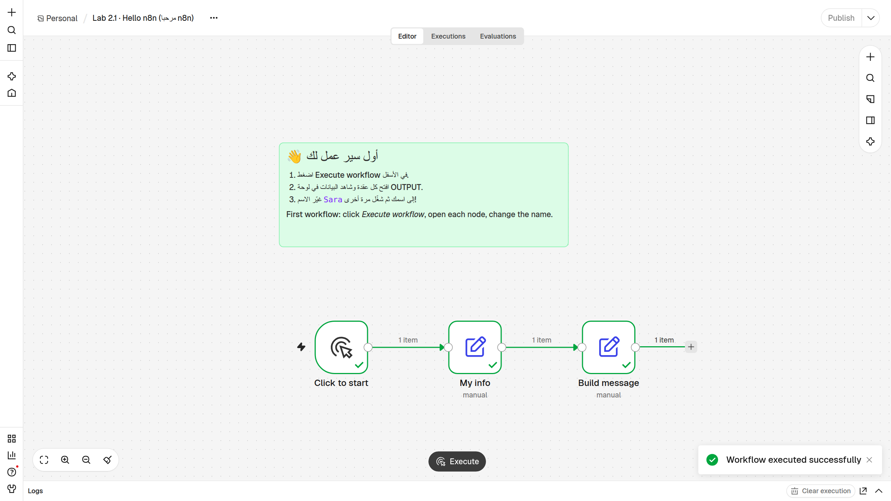
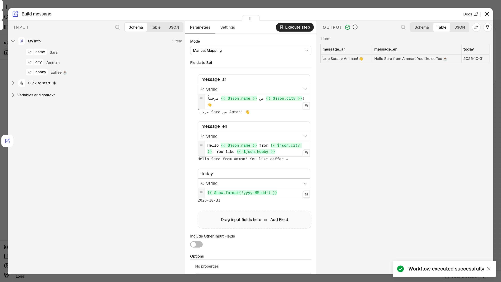
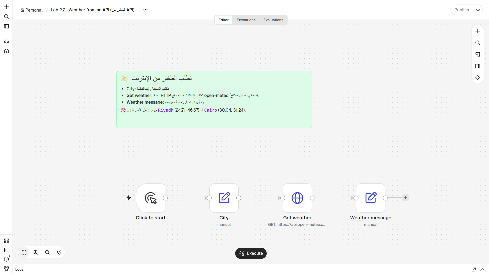
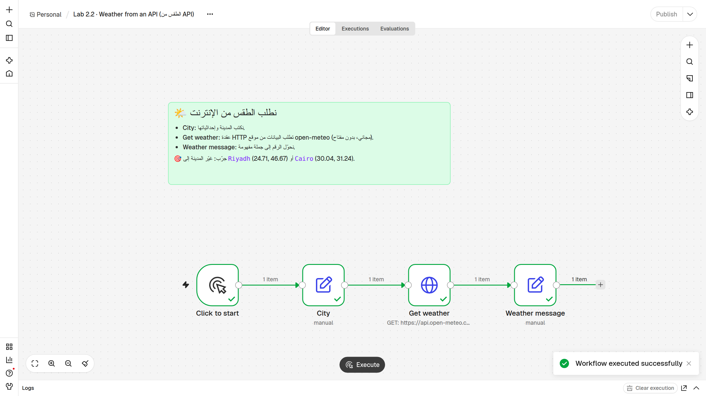
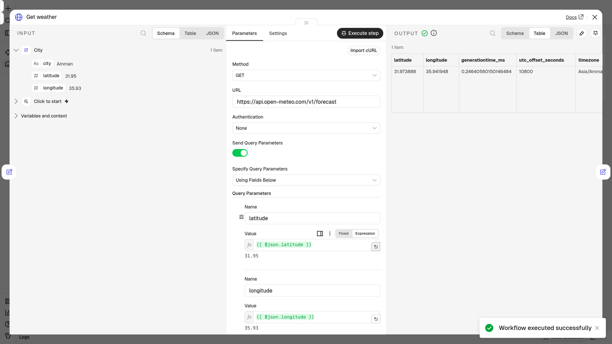

# 🧪 Lab 2 · تعرّف على n8n — Meet n8n

> **الحصة 2 · n8n من الصفر** — ثلاثة تمارين: نستورد سير عمل جاهزاً، ثم نجلب الطقس من الإنترنت، ثم نبني سير عمل من الصفر.
> **Class 2 · n8n from zero** — three exercises: import a ready workflow, fetch live weather from an API, then build one from scratch.

| التمرين / Lab | الملف / File | الوقت / Time |
|---|---|---|
| 2.1 · مرحباً n8n — Hello n8n | `hello-n8n.json` | ~15 دقيقة |
| 2.2 · الطقس من API — Weather from an API | `weather-api.json` | ~15 دقيقة |
| 2.3 · من الصفر — Build from scratch | (بدون ملف / no file) | ~20 دقيقة |

---

## 🎯 الهدف / Goal

بنهاية هذا التمرين ستكون قادراً على:

1. **استيراد** سير عمل جاهز (**Import ▸ From file**) وتشغيله بزر **Execute workflow**.
2. **قراءة البيانات** داخل أي عقدة: **INPUT** (ما دخل) · **Parameters** (الإعدادات) · **OUTPUT** (ما خرج)، بالعروض الثلاثة **Schema / Table / JSON**.
3. **استخدام التعبيرات** (Expressions) مثل `{{ $json.name }}` بالسحب والإفلات — "املأ الفراغ".
4. **طلب بيانات من الإنترنت** بعقدة **HTTP Request** (النادل 🧑‍🍳) من موقع مجاني لا يحتاج مفتاحاً.
5. **بناء** سير عمل صغير بنفسك من الصفر.

*By the end you can import and run a workflow, read INPUT / OUTPUT, use drag-and-drop expressions, call a free API with HTTP Request, and build a 3-node workflow yourself.*

---

## ✅ قبل أن تبدأ / Before you start

- [ ] حساب **n8n Cloud** يعمل (من `n8n.io` ← **Get started**). احفظ رابط مساحتك، مثل `yourname.app.n8n.cloud`.
- [ ] جهاز كمبيوتر (ليس هاتفاً) ومتصفح حديث: Chrome أو Edge أو Firefox.
- [ ] الملفان `hello-n8n.json` و `weather-api.json` محفوظان على جهازك (من المدرّب أو من مجلد `lab/`).
- [ ] اتصال إنترنت (تمرين 2.2 يطلب الطقس من `api.open-meteo.com`).

> 💡 **كلمات ستراها:** Node = عقدة (قطعة LEGO) · Trigger = مُشغِّل (متى يبدأ؟) · Item = استمارة واحدة تعبر السلك · Expression = فراغ يملؤه n8n.

---

## 🧪 Lab 2.1 · مرحباً n8n — Hello n8n (`hello-n8n.json`)

سير عمل من ثلاث عُقَد: **Click to start** (مُشغِّل يدوي) ← **My info** (معلوماتك) ← **Build message** (تكوين رسالة ترحيب).

### 🪜 الخطوات / Steps

1. من صفحة **Overview** اضغط الزر الوردي **Create workflow**.
   👀 *ترى لوحة رسم فارغة (Canvas) وفي وسطها زر **Add first step**.*
2. في الأعلى، بجانب اسم سير العمل، اضغط **⋯** (ثلاث نقاط).
   👀 *تظهر قائمة فيها **Import ▸ From file**.*
3. اضغط **Import ▸ From file** واختر الملف `hello-n8n.json`.
   👀 *تظهر ثلاث عُقَد موصولة بأسلاك، وفوقها ملاحظة خضراء بالعربي.*
   > ✋ طريقة بديلة: افتح الملف بمحرر نصوص (Notepad / TextEdit)، انسخ كل النص (`Ctrl+A` ثم `Ctrl+C`)، اضغط على مكان فارغ في اللوحة، ثم الصق `Ctrl+V` (على Mac: `Cmd+V`).
4. اضغط الزر **Execute workflow** في أسفل الشاشة (قد يظهر مكتوباً **Execute** فقط).
   👀 *تظهر علامة ✓ خضراء على كل عقدة، و **1 item** فوق كل سلك، ورسالة "Workflow executed successfully".*

   

5. اضغط مرتين على عقدة **My info**.
   👀 *تنفتح نافذة بثلاثة أعمدة: **INPUT** · **Parameters** · **OUTPUT**. في OUTPUT ترى `name = Sara` و `city = Amman` و `hobby = coffee ☕`.*
6. جرّب الأزرار **Schema** ثم **Table** ثم **JSON** فوق عمود OUTPUT.
   👀 *نفس البيانات بثلاثة أشكال: قائمة، جدول، ونص بين أقواس `{ }`.*
7. أغلق النافذة (✕ أعلى اليمين) واضغط مرتين على عقدة **Build message**.
   👀 *في الوسط ترى التعبيرات باللون الأخضر مثل `{{ $json.name }}`، وتحت كل حقل معاينة للنتيجة.*

   

8. أغلق النافذة، افتح **My info** مرة أخرى، وفي حقل `name` غيّر القيمة `Sara` إلى **اسمك**. (وإن أردت: غيّر `city` و `hobby` أيضاً.)
   👀 *القيمة الجديدة مكتوبة في الحقل.*
9. أغلق النافذة واضغط **Execute workflow** مرة أخرى.
   👀 *العلامات الخضراء تظهر من جديد.*
10. افتح **Build message** وانظر إلى **OUTPUT**.
    👀 *الرسالة الآن باسمك! لم نعدّل عقدة Build message أبداً — التعبيرات ملأت الفراغ وحدها.*

### 🎉 النتيجة المتوقعة / Expected result

في **OUTPUT** لعقدة **Build message** (قبل تغيير الاسم):

| الحقل / Field | القيمة / Value |
|---|---|
| `message_ar` | مرحباً Sara من Amman! 👋 |
| `message_en` | Hello Sara from Amman! You like coffee ☕ |
| `today` | تاريخ اليوم بالشكل `YYYY-MM-DD` (مثلاً `2026-10-31`) |

وبعد تغيير الاسم: `مرحباً <اسمك> من Amman! 👋`.

---

## 🌤️ Lab 2.2 · الطقس من API — Weather from an API (`weather-api.json`)

أربع عُقَد: **Click to start** ← **City** (المدينة وإحداثياتها) ← **Get weather** (عقدة HTTP Request = النادل 🧑‍🍳 يذهب إلى موقع open-meteo المجاني، بدون مفتاح) ← **Weather message** (تحويل الرقم إلى جملة).

### 🪜 الخطوات / Steps

1. من **Overview** اضغط **Create workflow**، ثم **⋯** ← **Import ▸ From file** واختر `weather-api.json`.
   👀 *أربع عُقَد وملاحظة خضراء "نطلب الطقس من الإنترنت".*

   

2. اضغط **Execute workflow**.
   👀 *✓ خضراء على العُقَد الأربع و **1 item** على كل سلك. (إذا ظهرت علامة حمراء على Get weather، راجع قسم المشاكل.)*

   

3. اضغط مرتين على **City**.
   👀 *ثلاثة حقول: `city = Amman`، `latitude = 31.95` (خط العرض)، `longitude = 35.93` (خط الطول).*
4. أغلقها واضغط مرتين على **Get weather**.
   👀 *في INPUT: بيانات City. في الوسط: Method = `GET` و URL = `https://api.open-meteo.com/v1/forecast`، وتحتها Query Parameters فيها `{{ $json.latitude }}` و `{{ $json.longitude }}`.*

   

5. في عمود **OUTPUT** اختر عرض **Schema** (أو **JSON**) وابحث عن `current` ثم بداخله `temperature_2m`.
   👀 *هذه درجة الحرارة الآن في عمّان! وبجانبها `wind_speed_10m` (سرعة الرياح) و `precipitation` (المطر).*
6. أغلق النافذة واضغط مرتين على **Weather message**.
   👀 *في الوسط حقل `message` فيه تعبيران: `{{ $json.current.temperature_2m }}` (من العقدة السابقة مباشرة) و `{{ $('City').item.json.city }}` (من عقدة أبعد اسمها City).*
7. انظر إلى **OUTPUT**.
   👀 *جملة كاملة بالعربي فيها اسم المدينة ودرجة الحرارة والرياح.*

### 🎉 النتيجة المتوقعة / Expected result

في **OUTPUT** لعقدة **Weather message**:

- `temperature` = رقم، مثل `21.7`
- `message` = جملة مثل:

> 🌡️ الطقس الآن في Amman: 21.7°C — الرياح 4.3 km/h

⚠️ **الأرقام عندك ستكون مختلفة** — إنه طقس حقيقي الآن! هذا طبيعي وليس خطأ.

---

## 🛠️ Lab 2.3 · من الصفر — Build from scratch (بدون ملف)

نبني ثلاث عُقَد بأنفسنا: **مُشغِّل يدوي** ← **About me** (3 حقول عنك) ← **Sentence** (جملة بالتعبيرات).

### 🪜 الخطوات / Steps

1. من **Overview** اضغط **Create workflow**.
   👀 *لوحة فارغة وزر **Add first step** في الوسط.*
2. اضغط **Add first step**، ثم اختر **Trigger manually**.
   👀 *تظهر أول عقدة (مُشغِّل يدوي)، قد يكون اسمها "When clicking ‘Execute workflow’".*
3. اضغط **+** الصغير على يمين المُشغِّل، واكتب في البحث `Edit Fields`، ثم اختر **Edit Fields (Set)**.
   👀 *تنفتح نافذة العقدة، والوضع (Mode) هو **Manual Mapping**.*
4. اضغط **Add Field**. في خانة الاسم اكتب `name`، واترك النوع **String**، وفي القيمة اكتب اسمك (مثلاً `Omar`).
   👀 *حقل واحد مكتوب.*
5. اضغط **Add Field** مرة أخرى: الاسم `city` والقيمة مدينتك (مثلاً `Irbid`).
6. اضغط **Add Field** مرة ثالثة: الاسم `hobby` والقيمة هوايتك (مثلاً `football ⚽`).
7. اضغط **Execute step** في أعلى النافذة.
   👀 *في **OUTPUT**: item واحد فيه `name` و `city` و `hobby`.*
8. أغلق النافذة. اضغط على العقدة مرة واحدة ثم `F2` وسمّها `About me` ثم `Enter`.
   👀 *اسم العقدة على اللوحة أصبح **About me**.*
9. اضغط **+** على يمين **About me** ← ابحث `Edit Fields` ← **Edit Fields (Set)**.
   👀 *نافذة جديدة. في عمود **INPUT** على اليسار ترى `name` و `city` و `hobby`.*
10. اضغط **Add Field** واكتب الاسم `sentence`.
11. في خانة القيمة اكتب `أنا ` ثم **اسحب** `name` من INPUT وأفلته داخل الخانة.
    👀 *ظهر `{{ $json.name }}` باللون الأخضر، وتحت الخانة معاينة فيها اسمك.*
12. أكمل الكتابة ` من ` ثم اسحب `city`، ثم اكتب ` وأحب ` واسحب `hobby`.
    👀 *المعاينة تحت الخانة: "أنا Omar من Irbid وأحب football ⚽".*
13. أغلق النافذة، وسمّ العقدة `Sentence` (بالضغط عليها ثم `F2`).
14. اضغط **Execute workflow** في الأسفل.
    👀 *✓ خضراء على العُقَد الثلاث و **1 item** على كل سلك.*
15. افتح **Sentence** وانظر إلى **OUTPUT**.
    👀 *جملتك الكاملة!* 🎉

### 🎉 النتيجة المتوقعة / Expected result

```
sentence = أنا Omar من Irbid وأحب football ⚽
```

(بمعلوماتك أنت طبعاً.) سير العمل:

```
[Trigger manually] ──1 item──▶ [About me] ──1 item──▶ [Sentence]
```

---

## 🛠️ إذا واجهت مشكلة / Troubleshooting

| المشكلة / Symptom | الحل / Fix |
|---|---|
| **لا أجد Import ▸ From file** | يجب أن تكون **داخل سير عمل مفتوح**، وليس في صفحة Overview. القائمة هي **⋯** بجانب اسم سير العمل في أعلى الشاشة (وليست نقاط المتصفح). إذا كانت النافذة ضيقة كبّرها. أو استخدم النسخ واللصق: انسخ نص الملف كله والصقه على اللوحة بـ `Ctrl+V`. |
| **اللصق Ctrl+V لا يفعل شيئاً** | اضغط أولاً على مكان فارغ في اللوحة ثم الصق. تأكد أنك نسخت **كل** النص: يبدأ بـ `{` وينتهي بـ `}`. |
| **رسالة "No output data"** عند فتح عقدة | العقدة لم تعمل بعد. اضغط **Execute workflow** في الأسفل، أو **Execute step** داخل العقدة. إذا كانت العقدة السابقة فارغة، شغّلها أولاً. |
| **التعبير يظهر `[undefined]` بالأحمر** أو المعاينة فارغة | اسم الحقل مكتوب خطأ: `name` ≠ `Name`، أو فيه مسافة زائدة. احذف التعبير و**اسحب** الحقل من INPUT بدل كتابته. إذا كانت المعلومة في عقدة أبعد، استخدم `{{ $('City').item.json.city }}`. |
| **ضغطت ولا شيء يحدث** / لا علامات خضراء | المُشغِّل اليدوي لا يعمل وحده: اضغط **Execute workflow** في الأسفل (وليس Publish). |
| **عقدة رمادية لم تعمل** | غالباً غير موصولة بسلك. اسحب من النقطة الصغيرة على يمين العقدة السابقة إلى النقطة على يسار العقدة التالية. |
| **علامة حمراء على Get weather** | تأكد من الإنترنت ومن الرابط `https://api.open-meteo.com/v1/forecast` (بدون مسافات). الإحداثيات بنقطة وليس فاصلة: `31.95` وليس `31,95`. انتظر دقيقة وجرّب مرة أخرى. |
| **الطقس باسم Riyadh لكن الرقم لم يتغير كثيراً / غريب** | غيّرت الاسم فقط! غيّر `latitude` و `longitude` أيضاً في عقدة City. |
| **انتهت التجربة المجانية / لا أستطيع الدخول** | أخبر المدرّب. يمكنك أيضاً تشغيل n8n مجاناً على جهازك (ملحق Docker في آخر شرائح الحصة). |

---

## 🚀 تحدّي / Challenges

من الأسهل إلى الأصعب — *easy → harder*:

1. ⭐ **(2.2) غيّر المدينة:** في عقدة **City** غيّر الحقول الثلاثة إلى **Riyadh** (`24.71`, `46.67`) أو **Cairo** (`30.04`, `31.24`) ثم شغّل. هل الجو أحرّ من عمّان؟
2. ⭐⭐ **(2.1) أضف حقلاً:** في **My info** أضف حقل `food` (أكلتك المفضلة)، ثم في **Build message** أضفه إلى `message_ar` بالسحب: "…وأكلتك المفضلة {{ $json.food }}".
3. ⭐⭐ **(2.2) أضف المطر:** في **Weather message** أضف إلى نهاية الجملة: ` — المطر {{ $json.current.precipitation }} mm` (اسحب `precipitation` من INPUT).
4. ⭐⭐⭐ **(2.3) أضف التاريخ واستخدم عقدة أبعد:** في عقدة **Sentence** أضف حقلاً اسمه `today` قيمته `{{ $now.format('yyyy-MM-dd') }}`، وحقلاً آخر يأخذ الاسم من عقدة About me مباشرة: `{{ $('About me').item.json.name }}`. لماذا يعطي نفس نتيجة `{{ $json.name }}` هنا؟

> 🏁 **أنهيت كل شيء؟** افتح تبويب **Executions** في أعلى سير العمل: سترى كل مرة شغّلت فيها، متى، وهل نجحت. اضغط على أي تشغيل لترى بياناته.
