# 🧪 Lab 3 · سير عمل جاهزة للتجربة — Flows You Can Try

> **n8n من الصفر · Class 3** — خمس أتمتة حقيقية: تستوردها، تربط حسابك، تشغّلها، ثم تغيّرها لتصبح لك.

---

## 🎯 الهدف / Goal

في نهاية هذا التمرين سيكون عندك **5 أتمتة تعمل** على n8n Cloud:

| الجزء | الملف | ماذا تفعل؟ |
|---|---|---|
| 3.1 | `form-to-sheet-email.json` | 📝 نموذج تواصل ← سطر في Google Sheets ← بريد لك |
| 3.2 | `daily-weather-email.json` | ☔ كل صباح 7:00: «خذ المظلة» أو «يوم جميل» (عقدة **IF**) |
| 3.3 | `webhook-alert.json` | 🔔 طلب جديد عبر **Webhook** ← تنبيه فقط إذا كان المبلغ أكبر من 100 |
| 3.4 | `news-digest.json` | 📰 أهم 5 أخبار من BBC عربي في بريد واحد كل صباح 8:00 |
| 3.5 | `error-alert.json` | 🚨 «كاشف الدخان»: بريد لك عند فشل أي أتمتة |

وستتدرّب على: ربط الحسابات (**Credentials**)، قراءة الطرق (**true / false**)، الفرق بين **Test URL** و **Production URL**، وقراءة الأخطاء.

---

## ✅ قبل أن تبدأ / Before you start

- [ ] حساب **n8n Cloud** يعمل، وأنت داخل المحرّر (راجع n8n.io/pricing لمعرفة مدة التجربة المجانية الحالية).
- [ ] حساب **Gmail** شخصي (حسابات العمل/المؤسسات قد تمنع ربط التطبيقات الخارجية).
- [ ] ملفات التمرين من مجلد `lab/` محفوظة على جهازك.
- [ ] تبويب متصفح مفتوح على **https://hoppscotch.io** (للجزء 3.3).

### 📥 طريقة الاستيراد (لكل الأجزاء) / How to import

1. من الصفحة الرئيسية (**Overview**) اضغط **Create workflow** ← يفتح محرّر فارغ.
2. بجانب اسم سير العمل (أعلى يسار المحرّر) اضغط **⋯** ← **Import ▸ From file** ← اختر ملف الـ JSON.
   - **طريقة بديلة:** افتح ملف الـ JSON بأي محرّر نصوص، انسخ كل النص (Ctrl+A ثم Ctrl+C)، ثم اضغط على اللوحة الفارغة والصق (**Ctrl+V**).
3. 👀 **ستشاهد:** العقد مرتّبة من اليسار لليمين، وفوقها ملاحظة لاصقة (Sticky note) تشرح الفكرة بالعربي. العقد التي تحتاج حساباً عليها **مثلث أحمر ⚠️** — هذا طبيعي.

### 🔑 طريقة ربط حساب Google (مرة واحدة فقط) / How to connect Google

1. افتح العقدة (نقر مزدوج) ← في الأعلى حقل **Credential**.
2. اضغط **Connect to Gmail** (أو **Create new credential**) ← ثم **Sign in with Google**.
3. اختر حسابك ← إذا ظهرت مربعات صلاحيات، **ضع علامة على كل المربعات** ← **Allow** / **Continue**.
4. 👀 **ستشاهد:** رسالة **Account connected** ✅. أغلق النافذة.
5. في المرات القادمة: لا تصنع مفتاحاً جديداً — فقط اختر نفس المفتاح من القائمة المنسدلة في حقل **Credential**.

> 💡 **Gmail** و **Google Sheets** مفتاحان منفصلان، لكن الخطوات نفسها.
> 🔒 لا تكتب أي كلمة سر داخل الحقول أو الملاحظات. مكان المفاتيح الوحيد هو **Credentials**.

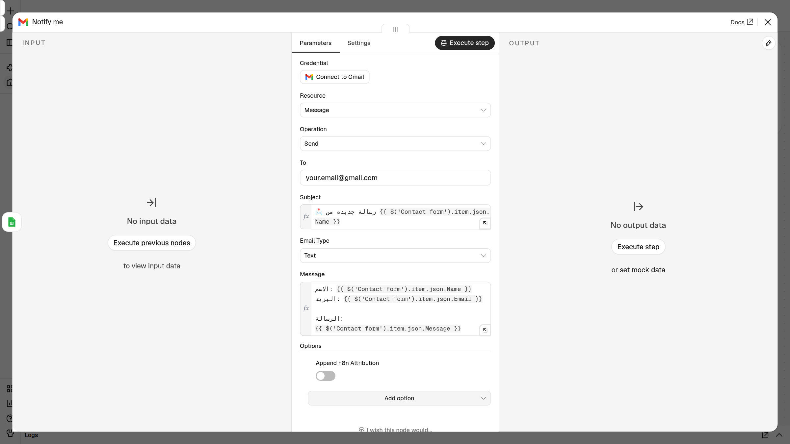

---

## 🪜 الخطوات / Steps

### 📝 الجزء 3.1 — نموذج تواصل ← جدول ← بريد · `form-to-sheet-email.json`

**القصة:** رسائل الزبائن تضيع بين الواتساب والإنستغرام. نريد نموذجاً واحداً، كل رد يُحفظ في جدول ويصلنا على البريد.

**أ) جهّز الجدول في Google Sheets**

1. افتح **https://sheets.new** (بنفس حساب Google) ← جدول جديد.
2. سمِّه مثلاً `Contact form replies` (اضغط على «Untitled spreadsheet» في الأعلى).
3. اكتب في السطر الأول بالضبط — **الحروف الكبيرة مهمة**:
   - الخلية `A1`: `Name`
   - الخلية `B1`: `Email`
   - الخلية `C1`: `Message`
4. 👀 **ستشاهد:** ثلاثة عناوين في السطر الأول، والباقي فارغ.

**ب) استورد واربط**

5. استورد `form-to-sheet-email.json` (انظر «طريقة الاستيراد» بالأعلى).
   👀 **ستشاهد:** ثلاث عقد: **Contact form** ← **Save to sheet** ← **Notify me**.

   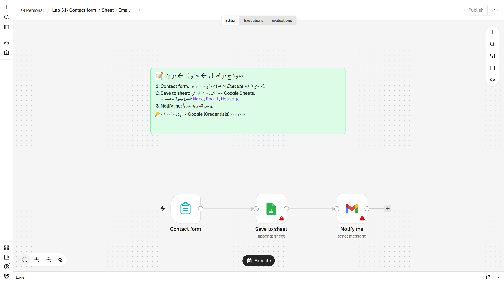

6. افتح **Save to sheet** ← **Credential** ← اربط **Google Sheets** بـ **Sign in with Google**.
7. في نفس العقدة: **Document** ← **From list** ← اختر `Contact form replies`.
8. **Sheet** ← اختر الورقة الأولى (`Sheet1` أو `ورقة1`).
9. تأكّد أن **Mapping Column Mode** = **Map Automatically** (موجود مسبقاً). أغلق العقدة.
   👀 **ستشاهد:** اختفى المثلث الأحمر عن **Save to sheet**.
10. افتح **Notify me** ← **Credential** ← اربط **Gmail** (أو اختره إن كان موجوداً).
11. في حقل **To** امسح `your.email@gmail.com` واكتب **بريدك أنت**. أغلق العقدة.

**ج) شغّل وجرّب**

12. اضغط زر **Execute workflow** في أسفل اللوحة (في n8n 2.45 مكتوب عليه **Execute** فقط).
    👀 **ستشاهد:** يفتح n8n النموذج في تبويب جديد، وفي أعلاه «This is a test version of your form».
    > إذا لم يفتح التبويب (المتصفح منع النوافذ المنبثقة): افتح عقدة **Contact form** ← انسخ **Test URL** ← الصقه في المتصفح.

    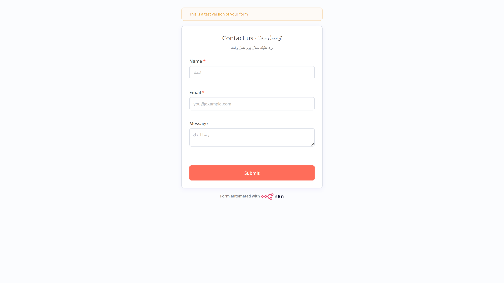

13. املأ **Name** و **Email** و **Message** ثم اضغط **Submit**.
    👀 **ستشاهد:** رسالة تأكيد أن الرد وصل.
14. ارجع إلى n8n.
    👀 **ستشاهد:** العقد الثلاث **خضراء** ✅ وعلى الأسلاك `1 item`.
15. افتح الجدول ← سطر جديد فيه بياناتك. وافتح بريدك ← رسالة عنوانها «📩 رسالة جديدة من …».

> ℹ️ قد تظهر في الجدول أعمدة إضافية مثل `submittedAt` (وقت الإرسال) و `formMode` (test/production). هذا **طبيعي**: n8n يضيف أي حقل لا يجد له عموداً. لإيقاف ذلك: **Save to sheet** ← **Options** ← **Handling extra fields** ← **Ignore Them**.

**د) اجعله حقيقياً (اختياري)**

16. اضغط **Publish** (أعلى اليمين). ثم افتح **Contact form** ← تبويب **Production URL** ← هذا هو الرابط الذي تشاركه مع زبائنك؛ يعمل دائماً دون الضغط على Execute.

---

### ☔ الجزء 3.2 — بريد الطقس اليومي · `daily-weather-email.json`

**القصة:** كل صباح الساعة 7:00 يسأل n8n عن الطقس، ثم تقرّر عقدة **IF**: هل احتمال المطر أكبر من 50٪؟

1. استورد `daily-weather-email.json`.
   👀 **ستشاهد:** **Every day 7:00** ← **Forecast** ← **Rain likely?** ثم طريقان: **true** ← **Umbrella email** و **false** ← **Sunny email**.

   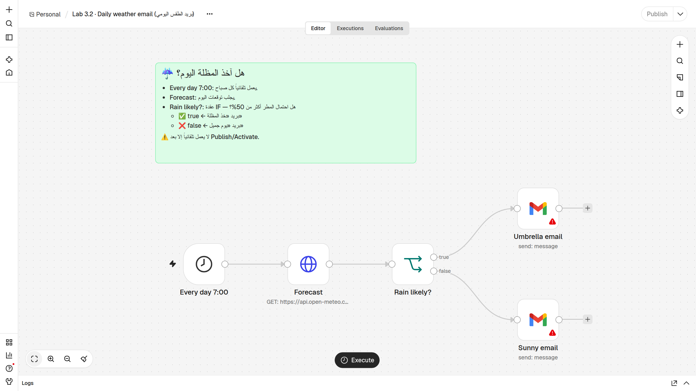

2. (اختياري) افتح **Forecast** ← **Query Parameters** ← غيّر `latitude` و `longitude` لمدينتك. الافتراضي عمّان:

   | المدينة | latitude | longitude |
   |---|---|---|
   | عمّان | 31.95 | 35.93 |
   | إربد | 32.56 | 35.85 |
   | الرياض | 24.71 | 46.68 |
   | جدة | 21.49 | 39.19 |
   | دبي | 25.20 | 55.27 |
   | الدوحة | 25.29 | 51.53 |
   | الكويت | 29.38 | 47.98 |
   | القاهرة | 30.04 | 31.24 |

   > مدينة أخرى؟ ابحث في Google عن: `اسم المدينة coordinates`.
3. افتح **Umbrella email** ← **Credential** ← اختر مفتاح Gmail ← غيّر **To** إلى بريدك.
4. افتح **Sunny email** ← نفس الشيء (**عقدتان** تحتاجان المفتاح والبريد!).
5. اضغط **Execute workflow**.
   👀 **ستشاهد:** **Forecast** و **Rain likely?** خضراوان، ثم **عقدة بريد واحدة فقط** تصبح خضراء؛ الأخرى تبقى رمادية لأنها لم تعمل اليوم.
6. افتح **Rain likely?** ← في **OUTPUT** ستجد العنصر في **True Branch** أو **False Branch**.

   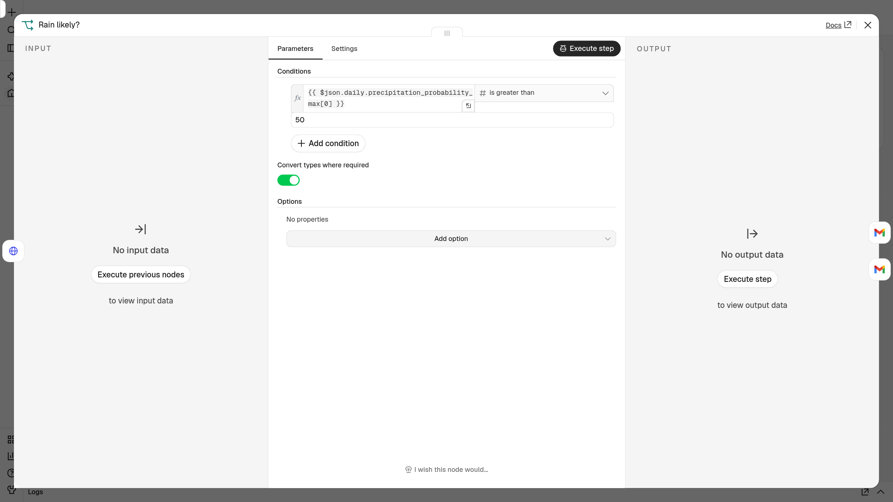

7. افتح بريدك ← «☔ خذ المظلة اليوم!» أو «☀️ يوم جميل بلا مطر» مع الاحتمال ودرجات الحرارة.
8. 🔁 **جرّب الطريق الآخر:** في **Rain likely?** غيّر `50` إلى `-1` (فيصبح الشرط صحيحاً دائماً) ← **Execute workflow** ← يصلك البريد الآخر. **أرجعها إلى 50** بعد التجربة.
9. **ليعمل كل يوم وحده:** اضغط **Publish** (في النسخ القديمة: مفتاح **Active**). **وللتجربة الآن:** اضغط **Execute workflow**.
10. تأكّد من التوقيت: **⋯** ← **Settings** ← **Timezone** ← اختر منطقتك (مثلاً `Asia/Amman` أو `Asia/Riyadh` أو `Asia/Dubai`) ← **Save**.

> ⚠️ لا تريد رسالة كل صباح؟ أوقف النشر (**Unpublish**) من القائمة بجانب زر **Publish**.

---

### 🔔 الجزء 3.3 — تنبيه الطلبات الكبيرة · `webhook-alert.json`

**القصة:** متجرك «يرن جرس الباب» (Webhook) عند كل طلب. نريد تنبيهاً **فقط** إذا كان المبلغ أكبر من 100.

1. استورد `webhook-alert.json`.
   👀 **ستشاهد:** **New order** (Webhook) ← **Big order?** (IF) ← **true**: **Alert me** / **false**: **Small order**.

   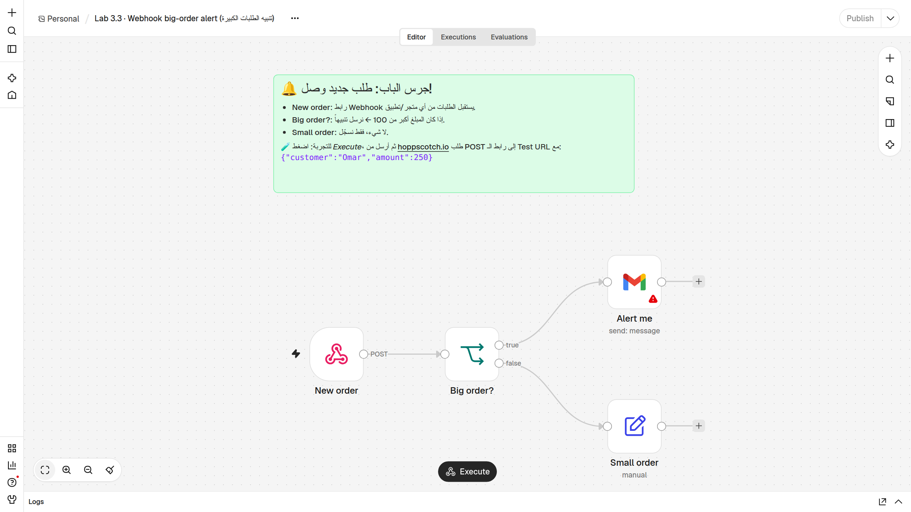

2. افتح **Alert me** ← اختر مفتاح Gmail ← غيّر **To** إلى بريدك.
3. افتح **New order** ← **Webhook URLs** ← تبويب **Test URL** ← اضغط على الرابط لنسخه.
   👀 **ستشاهد:** رابطاً ينتهي بـ `/webhook-test/new-order` (على n8n Cloud يبدأ باسم حسابك، وليس `localhost` كما في الصورة).

   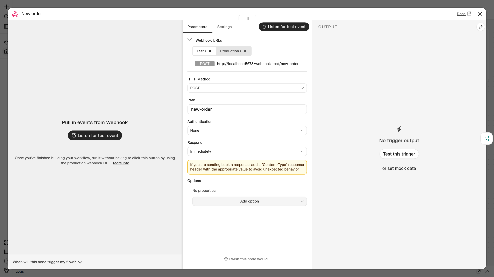

4. أغلق العقدة واضغط **Execute workflow**.
   👀 **ستشاهد:** العقدة **New order** في حالة انتظار/استماع (**Listening for test event**). **لا تتأخر** — الاستماع لفترة قصيرة ولطلب واحد فقط.

**أرسل طلباً تجريبياً من hoppscotch.io**

5. في **hoppscotch.io**: غيّر الطريقة من **GET** إلى **POST** (القائمة على يسار شريط الرابط).
6. الصق الـ **Test URL** في شريط الرابط.
7. تحت الشريط افتح تبويب **Body** ← **Content Type** ← اختر **application/json**.
8. الصق في مربع النص:

   ```json
   {"customer":"Omar","amount":250}
   ```

9. اضغط **Send**.
   👀 **ستشاهد في hoppscotch:** `200 OK` ورداً مثل `{"message":"Workflow was started"}`.
10. ارجع إلى n8n.
    👀 **ستشاهد:** **New order** ← **Big order?** ← **Alert me** خضراء ✅. وفي بريدك: «💰 طلب كبير: 250 من Omar».
11. 🔁 **الطريق الآخر:** اضغط **Execute workflow** مرة أخرى، وأرسل `{"customer":"Lina","amount":40}`.
    👀 **ستشاهد:** الطريق يذهب إلى **Small order**. افتحها ← **OUTPUT** فيه: `طلب صغير (40) — لا حاجة لتنبيه`.

> 💡 لاحظ: n8n يضع البيانات التي أرسلتها داخل `body`، لذلك الشرط هو `{{ $json.body.amount }}`.

**بديل: الطرفية (curl)** — بعد الضغط على **Execute workflow**، ضع رابطك مكان `TEST_URL`:

- **Mac / Linux (Terminal):**

  ```bash
  curl -X POST "TEST_URL" -H "Content-Type: application/json" -d '{"customer":"Omar","amount":250}'
  ```

- **Windows (Command Prompt / cmd):**

  ```bat
  curl -X POST "TEST_URL" -H "Content-Type: application/json" -d "{\"customer\":\"Omar\",\"amount\":250}"
  ```

**اجعله حقيقياً (اختياري):** اضغط **Publish** ← استخدم **Production URL** (فيه `/webhook/` بدل `/webhook-test/`) — يعمل دائماً بدون Execute، وهذا الرابط هو الذي تضعه في متجرك أو تطبيقك.

---

### 📰 الجزء 3.4 — ملخص الأخبار الصباحي · `news-digest.json`

**القصة:** أهم 5 عناوين من BBC عربي في رسالة واحدة مرتبة كل صباح 8:00.

1. استورد `news-digest.json`.
   👀 **ستشاهد:** **Every day 8:00** ← **BBC Arabic RSS** ← **Top 5** ← **Combine** ← **Send digest**.

   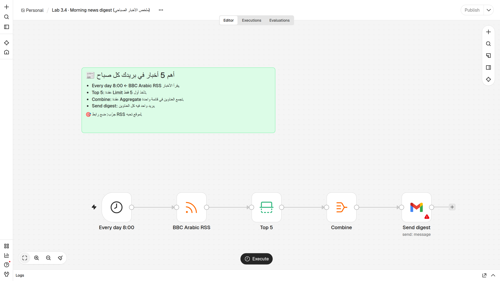

2. افتح **Send digest** ← اختر مفتاح Gmail ← غيّر **To** إلى بريدك.
3. اضغط **Execute workflow**.
   👀 **ستشاهد:** الأرقام على الأسلاك: `1 item` ← حوالي `26 items` (العدد يتغيّر حسب اليوم) ← `5 items` ← `1 item`.
4. افتح **Top 5** ← **OUTPUT**: خمسة عناصر فقط (هذه عقدة **Limit**).
5. افتح **Combine** ← **OUTPUT** ← عرض **Schema**: عنصر واحد فيه قائمة `title` وقائمة `link` (هذه عقدة **Aggregate** — «السلة»).
6. افتح بريدك ← «📰 أخبار الصباح — تاريخ اليوم» وفيه خمسة عناوين مرقّمة وتحت كل عنوان رابطه.
7. **ليعمل كل يوم وحده:** اضغط **Publish**. **وللتجربة الآن:** اضغط **Execute workflow**. (وتأكّد من **Settings ← Timezone** كما في 3.2.)

> 🔍 **هكذا يبدو الخطأ إذا نسيت المفتاح** — العقد قبل البريد خضراء، و **Send digest** حمراء:
>
> 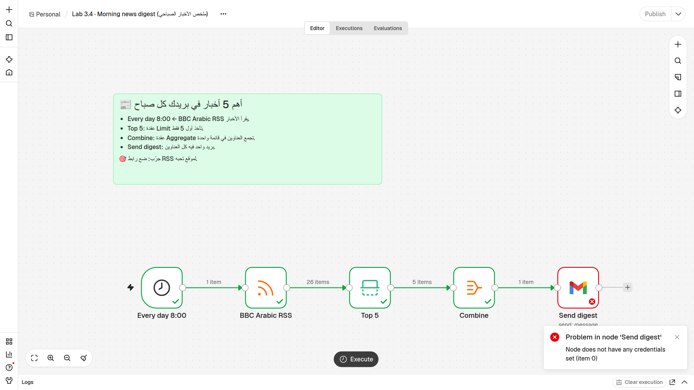
>
> افتح العقدة الحمراء: **INPUT** سليم (5 عناوين)، و **OUTPUT** فيه رسالة الخطأ. الحل: اختر مفتاح Gmail وشغّل من جديد.
>
> 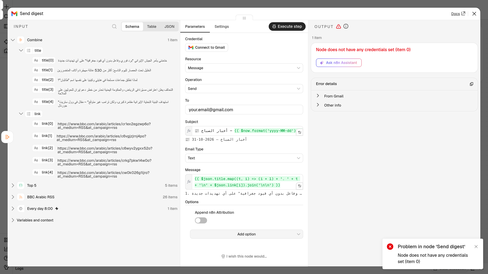

---

### 🚨 الجزء 3.5 — كاشف الدخان: تنبيه الأخطاء · `error-alert.json`

**القصة:** أتمتتك المنشورة تعمل وأنت نائم. إذا فشلت، تريد أن تعرف فوراً — مثل كاشف الدخان.

1. استورد `error-alert.json`.
   👀 **ستشاهد:** عقدتين: **When a workflow fails** (Error Trigger) ← **Email the error**.

   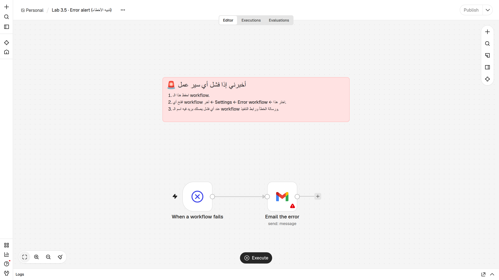

2. افتح **Email the error** ← اختر مفتاح Gmail ← غيّر **To** إلى بريدك.
3. احفظ (**Ctrl+S**) إذا لم يُحفظ تلقائياً. هذه الأتمتة **لا تحتاج Publish**.
4. اضغط **Execute workflow** لتجربة البريد.
   👀 **ستشاهد:** عند التشغيل اليدوي يعطي الـ Error Trigger **بيانات مثال** (اسم workflow ورسالة خطأ تجريبية)، فيصلك بريد «🚨 فشل: …». هذا يثبت أن البريد يعمل.
5. **اربطه بأتمتة أخرى:** افتح أتمتة 3.4 (ملخص الأخبار) ← **⋯** (بجانب اسم سير العمل، أعلى اليسار) ← **Settings** ← **Error workflow** ← اختر **Lab 3.5 · Error alert (تنبيه الأخطاء)** ← **Save**.
6. كرّر الخطوة 5 لكل أتمتة منشورة (3.2، 3.3، …).

> ⚠️ **مهم:** «الكاشف» يرنّ عند فشل **التشغيل التلقائي** (بعد **Publish**: موعد Schedule أو طلب على Production URL). عند الضغط على **Execute workflow** أنت ترى الخطأ أمامك على الشاشة، فلا يُرسَل بريد.

**أين أجد إعدادات الخطأ لكل عقدة؟** افتح أي عقدة ← تبويب **Settings** (بجانب **Parameters**):

| الإعداد | ماذا يحدث؟ |
|---|---|
| **On Error → Stop Workflow** | يتوقف كل شيء (الافتراضي). |
| **On Error → Continue** | يكمل، ويمرّر الخطأ كبيانات للعقدة التالية. |
| **On Error → Continue (using error output)** | يظهر مخرج ثانٍ للأخطاء لتبني طريقاً بديلاً. |
| **Retry On Fail** | يعيد المحاولة تلقائياً (Max Tries / Wait Between Tries). |

---

## 🎉 النتيجة المتوقعة / Expected result

- [ ] **3.1:** سطر جديد في الجدول + بريد «📩 رسالة جديدة من …».
- [ ] **3.2:** بريد واحد فقط: ☔ أو ☀️، فيه احتمال المطر ودرجات الحرارة. (وجرّبت الطريق الآخر.)
- [ ] **3.3:** طلب 250 ← بريد «💰 طلب كبير»؛ طلب 40 ← **Small order** بلا بريد.
- [ ] **3.4:** بريد واحد فيه 5 عناوين مرقّمة مع روابطها.
- [ ] **3.5:** بريد خطأ تجريبي، والكاشف مربوط بأتمتة 3.4 من **Settings ← Error workflow**.

---

## 🛠️ إذا واجهت مشكلة / Troubleshooting

| المشكلة (Symptom) | السبب المحتمل | الحل (Fix) |
|---|---|---|
| عقدة حمراء: `Node does not have any credentials set` | لم تختر مفتاحاً لهذه العقدة | افتح العقدة ← **Credential** ← اختر المفتاح أو **Connect to Gmail** ← شغّل من جديد. تذكّر: في 3.2 عقدتا Gmail. |
| خطأ `401` / `Unauthorized` / `invalid_grant` من Google | المفتاح انتهى أو سُحب الإذن | **Overview ← Credentials** ← افتح المفتاح ← **Sign in with Google** مرة أخرى. |
| خطأ `403` / `Insufficient Permission` | لم تضع علامة على كل مربعات الصلاحيات عند الربط | أعد الربط، وضع علامة على **كل** المربعات ثم **Allow**. |
| زر **Sign in with Google** يرفض أو يقول إن المسؤول منع التطبيق | حساب عمل/مؤسسة يمنع التطبيقات الخارجية | استخدم حساب Gmail شخصياً. |
| البيانات في أعمدة خاطئة أو ظهرت أعمدة جديدة `Name ` | عناوين الأعمدة لا تطابق أسماء الحقول تماماً | السطر الأول يجب أن يكون **بالضبط** `Name` `Email` `Message` (حروف كبيرة، بلا مسافات زائدة). |
| ظهرت أعمدة `submittedAt` و `formMode` | n8n يضيف الحقول التي لا عمود لها | طبيعي. أو: **Options ← Handling extra fields ← Ignore Them**. |
| الجدول لا يظهر في قائمة **Document** | جدول في حساب Google آخر | اربط نفس الحساب، أو اختر **By URL** والصق رابط الجدول. |
| النموذج لا يفتح بعد **Execute** | المتصفح منع النافذة المنبثقة | انسخ **Test URL** من عقدة **Contact form** والصقه في تبويب جديد. |
| Webhook يرد بخطأ `404` (`webhook … is not registered`) | لم تضغط **Execute** قبل الإرسال، أو انتهى الاستماع، أو استُخدم الطلب الواحد | اضغط **Execute workflow** ثم أرسل فوراً. أرسل طلباً واحداً لكل Execute. |
| `404` مع **Production URL** | الأتمتة غير منشورة، أو الرابط خطأ | اضغط **Publish**. تأكّد أن الرابط فيه `/webhook/new-order` (وليس `-test`). |
| `404` رغم أن n8n يستمع | الطريقة **GET** بدل **POST**، أو خطأ في كتابة المسار | اختر **POST** في hoppscotch. انسخ الرابط بالضغط عليه بدل كتابته. |
| الطلب 250 ذهب إلى **false** | الـ Body أُرسل كنص وليس JSON، فلم يُقرأ `amount` | في hoppscotch: **Body ← Content Type ← application/json**. افتح **New order ← OUTPUT** وتأكّد من وجود `body.amount`. |
| hoppscotch يظهر خطأ شبكة / CORS | المتصفح منع الطلب | جرّب مرة أخرى، أو من إعدادات hoppscotch اختر **Interceptor ← Proxy**، أو استخدم **curl**. |
| لم يصل بريد الطقس/الأخبار في الموعد | الأتمتة غير منشورة، أو المنطقة الزمنية مختلفة | اضغط **Publish**. **⋯ ← Settings ← Timezone** ← اختر منطقتك. |
| عدّلت أتمتة منشورة لكن التشغيل التلقائي ما زال قديماً | التعديل لم يُنشر بعد | اضغط **Publish** مرة أخرى بعد كل تعديل. |
| البريد لا يظهر في الوارد | ذهب إلى **Spam** / الرسائل غير المرغوب فيها | افتح Spam ← **Not spam**. |
| RSS: خطأ أو `0 items` | الموقع لا يرد مؤقتاً، أو الرابط خطأ | جرّب بعد دقيقة، وتأكّد من الرابط `https://feeds.bbci.co.uk/arabic/rss.xml`. |
| بريد الملخص فيه خطأ مثل `Cannot read properties of undefined` | غيّرت **Combine** فلم يعد فيها `title` و `link` | تأكّد أن **Combine** تجمع الحقلين `title` و `link`. |
| بريد الخطأ (3.5) لا يصل أبداً | الفشل كان أثناء **Execute** يدوي، أو لم تختر **Error workflow** | الكاشف يعمل للتشغيل التلقائي فقط. تأكّد من **Settings ← Error workflow** في الأتمتة الأخرى. |

**قائمة الفحص السريعة:** هل اشتغل المُشغِّل؟ ← افتح أول عقدة حمراء واقرأ الرسالة ← افحص **INPUT** ← ثبّت البيانات (**Pin data** 📌) ← جرّب عقدة واحدة (**Execute step**) ← راجع تبويب **Executions**.

---

## 🚀 تحدّي / Challenges

ابدأ بالسهل ⭐ ثم انتقل للأصعب ⭐⭐⭐.

### 3.1 · نموذج التواصل

- ⭐ أضف حقلاً جديداً **Phone** في **Contact form** (**Add Form Element**)، وعموداً `Phone` في الجدول، وأضف الهاتف إلى رسالة **Notify me**.
- ⭐⭐ **رد تلقائي للزبون:** أضف عقدة **Gmail** بعد **Notify me**؛ في **To** اكتب `{{ $('Contact form').item.json.Email }}` وفي الموضوع «شكراً لتواصلك 🌷».
- ⭐⭐⭐ أضف عقدة **IF** بعد **Contact form**: إذا كانت **Message** تحتوي (**contains**) كلمة «عاجل» ← أرسل البريد؛ وإلا ← احفظ في الجدول فقط.

### 3.2 · بريد الطقس

- ⭐ ضع إحداثيات مدينتك، وغيّر 50 إلى 30.
- ⭐⭐ غيّر الموعد إلى 6:30 (في **Every day 7:00**: **Trigger at Hour** = 6 و **Trigger at Minute** = 30)، وغيّر اسم العقدة ليطابق الموعد.
- ⭐⭐⭐ استبدل **IF** بعقدة **Switch** بثلاثة طرق: مطر (> 50٪)، حر شديد (`{{ $json.daily.temperature_2m_max[0] }}` > 35) ← «اشرب ماء كثيراً»، وإلا ← «يوم جميل».

### 3.3 · تنبيه الطلبات

- ⭐ أرسل طلباً بمبلغ 40 ثم بمبلغ 100 بالضبط — أي طريق؟ لماذا؟ ثم غيّر الحد من 100 إلى 500.
- ⭐⭐ في طريق **false** أضف **Google Sheets (Append)** لتسجيل كل الطلبات الصغيرة في جدول.
- ⭐⭐⭐ استبدل **IF** بـ **Switch**: أكبر من 500 ← «VIP 👑»، أكبر من 100 ← «طلب كبير»، والباقي ← «طلب صغير».

### 3.4 · ملخص الأخبار

- ⭐ اجعلها **Top 3** (في عقدة **Top 5** غيّر **Max Items**، وغيّر اسم العقدة).
- ⭐⭐ ضع رابط RSS لموقع آخر، مثلاً BBC بالإنجليزية: `https://feeds.bbci.co.uk/news/world/rss.xml` (أو ابحث عن «اسم الموقع RSS»).
- ⭐⭐⭐ أضف عقدة **Filter** قبل **Top 5** تُبقي فقط الأخبار التي يحتوي عنوانها (`title`) على كلمة تهمّك.

### 3.5 · كاشف الدخان

- ⭐ أضف إلى الرسالة رقم التنفيذ `{{ $json.execution.id }}` أو الوقت `{{ $now }}`.
- ⭐⭐ اربط الكاشف بكل أتمتتك المنشورة (**Settings ← Error workflow**).
- ⭐⭐⭐ **اختبار حقيقي:** انسخ أتمتة 3.4، غيّر رابط RSS إلى رابط خاطئ (مثل `https://feeds.bbci.co.uk/arabic/wrong.xml`)، اجعل المُشغِّل **كل دقيقة**، اربط **Error workflow**، ثم **Publish**. انتظر دقيقة أو اثنتين ← يصلك بريد الخطأ 🚨. **لا تنسَ Unpublish بعدها!**

### 🎁 إضافي: إعدادات الخطأ

- في أتمتة 3.4 افتح **BBC Arabic RSS** ← **Settings** ← فعّل **Retry On Fail** (مثلاً **Max Tries** = 3). ما فائدة ذلك إذا كان الموقع بطيئاً أحياناً؟
