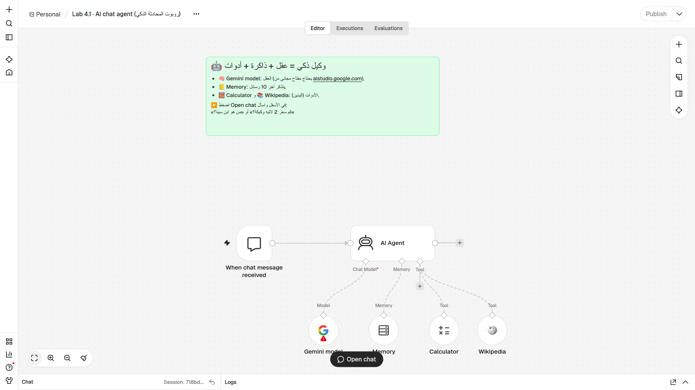
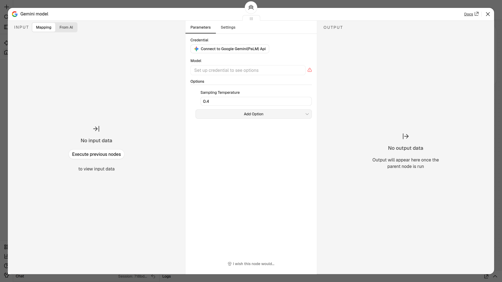
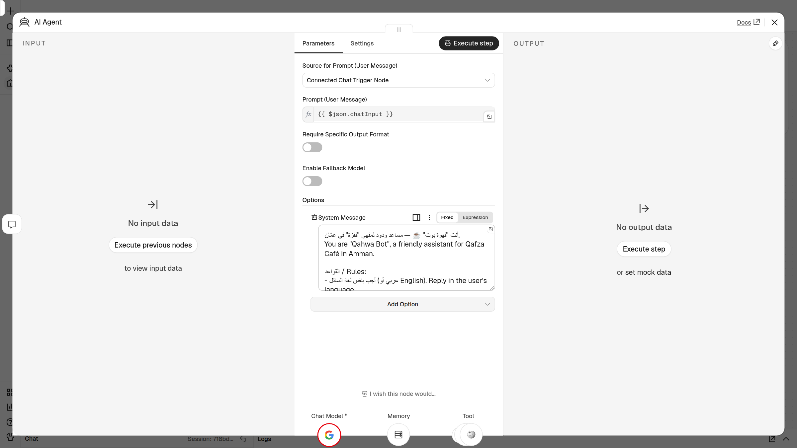
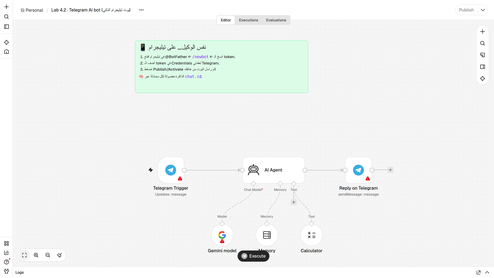
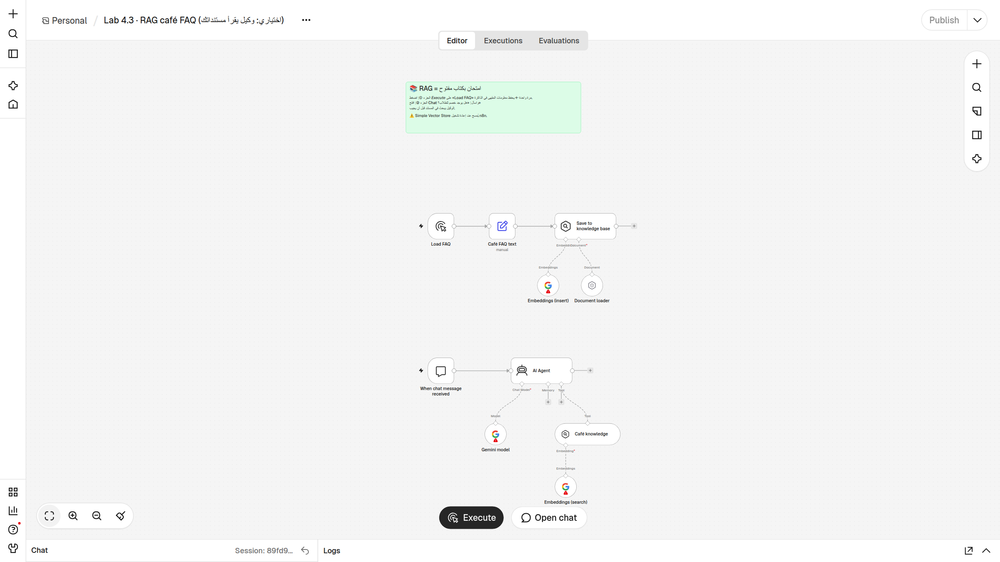

# 🧪 Lab 4 · ابنِ مساعدك الذكي / Build Your AI Assistant

**الحصة 4 · n8n من الصفر** — مدة اللاب: حوالي 45–60 دقيقة

> ⚠️ **ملاحظة مهمة:** ردود الذكاء الاصطناعي في هذا الملف **أمثلة**. ردودك ستكون قريبة في المعنى لكن بكلمات مختلفة، وهذا طبيعي. النموذج يكتب الرد من جديد في كل مرة.
> AI replies below are **examples**. Yours will have the same meaning, with different words.

---

## 🎯 الهدف / Goal

في نهاية هذا اللاب سيكون عندك:

1. **مفتاح Gemini مجاني** (بطاقة العضوية) محفوظ في n8n كـ **Credential**.
2. **«قهوة بوت» ☕** يعمل داخل n8n: وكيل ذكي (**AI Agent**) له شخصية، ويتذكّر اسمك (**Memory**)، ويحسب بالآلة الحاسبة (**Calculator**)، ويبحث في الموسوعة (**Wikipedia**).
3. **نفس الوكيل على تيليجرام**، تراسله من هاتفك.
4. (اختياري) وكيل يجيب من **مستند الأسئلة الشائعة** للمقهى (**RAG**).

تذكّر المعادلة: **الوكيل = عقل (Chat Model) + دفتر ملاحظات (Memory) + يدان (Tools)**.

---

## ✅ قبل أن تبدأ / Before you start

- [ ] حساب **n8n Cloud** يعمل (التجربة المجانية من الحصة 2)، وتستطيع فتح المحرر.
- [ ] حساب **Google** تعرف كلمة سرّه (لأخذ مفتاح Gemini).
- [ ] تطبيق **Telegram** على هاتفك أو حاسوبك، ومسجّل الدخول فيه.
- [ ] ملفات اللاب الثلاثة في مجلد `lab/`:
  - `chat-agent.json` (Lab 4.1)
  - `telegram-agent.json` (Lab 4.2)
  - `rag-faq.json` (Lab 4.3، اختياري)

**تذكير: كيف تستورد ملف JSON؟ / How to import**
في محرر سير العمل، بجانب اسم سير العمل (أعلى اليسار) اضغط **⋯ ← Import ▸ From file** واختر الملف.
أو افتح الملف بأي محرر نصوص، انسخ كل النص، ثم اضغط على اللوحة الفارغة و**Ctrl+V**.

---

## 🪜 الخطوات / Steps

### 🔑 Lab 4.0 — مفتاح Gemini المجاني / Get your free Gemini API key

1. افتح الرابط **https://aistudio.google.com/apikey** في المتصفح.
   👀 ترى صفحة **Google AI Studio**، وقد تطلب منك تسجيل الدخول.
2. سجّل الدخول بحساب Google، واقبل الشروط إذا ظهرت لك.
   👀 ترى صفحة **API Keys**.
3. اضغط **Create API key**. إذا سألك عن مشروع (project)، اقبل الخيار الافتراضي أو أنشئ مشروعاً جديداً.
   👀 يظهر مفتاح طويل، يبدأ عادةً بالحروف `AIza`.
4. اضغط زر النسخ بجانب المفتاح.
   👀 المفتاح الآن في الحافظة (clipboard). **لا تلصقه في أي مكان غير n8n.**

> 🔐 **المفتاح مثل كلمة السر.** من يملكه يستخدم حصّتك. لا ترسله في مجموعة، ولا تصوّره في لقطة شاشة. إذا تسرّب، احذفه من نفس الصفحة وأنشئ مفتاحاً جديداً.

---

### 💬 Lab 4.1 — قهوة بوت داخل n8n / Chat agent (`chat-agent.json`)

**أ) الاستيراد وإضافة المفتاح**

1. في n8n اضغط **Create Workflow** (أو **+** ثم Workflow) لفتح سير عمل جديد فارغ.
   👀 ترى لوحة فارغة.
2. بجانب اسم سير العمل (أعلى اليسار): **⋯ ← Import ▸ From file** واختر `chat-agent.json`.
   👀 تظهر ملاحظة خضراء، وتحتها: **When chat message received** ← **AI Agent**، وتحت الوكيل أربع دوائر: **Gemini model**، **Memory**، **Calculator**، **Wikipedia**. على **Gemini model** علامة ⚠️ حمراء (المفتاح ناقص).

   

3. انقر مرتين على **Gemini model**.
   👀 تفتح نافذة العقدة، وفيها **Credential** و**Model** (فارغ: «Set up credential to see options») و**Sampling Temperature = 0.4**.

   

4. اضغط على حقل **Credential** واختر **Create new credential** (أو الزر «Connect to Google Gemini(PaLM) Api»).
   👀 تفتح نافذة فيها حقل **API Key** (وحقل **Host** اتركه كما هو).
5. الصق المفتاح في **API Key**، ثم اضغط **Save**.
   👀 رسالة خضراء: **Connection tested successfully**. أغلق نافذة الـ Credential.
6. افتح قائمة **Model**.
   👀 تظهر قائمة نماذج. اترك النموذج المختار، أو اختر نموذجاً فيه كلمة **flash** (مثل `gemini-2.5-flash`). إذا ظهر لاحقاً خطأ «model not found» ارجع هنا واختر نموذج flash آخر.
7. أغلق نافذة العقدة (X أعلى اليمين).
   👀 اختفت العلامة الحمراء عن **Gemini model**.

**ب) نظرة داخل الوكيل** (لا تغيّر شيئاً)

8. انقر مرتين على **AI Agent**.
   👀 **Source for Prompt** = «Connected Chat Trigger Node»، و**Prompt** = `{{ $json.chatInput }}`، وتحت **Options** تجد **System Message**: الوصف الوظيفي لقهوة بوت (الدور، الأسعار، الساعات، القواعد).

   

9. اقرأ رسالة النظام، ثم أغلق النافذة.

**ج) جرّب المحادثة: سكربت الاختبار**

10. اضغط **Open chat** في أسفل منتصف اللوحة.
    👀 تفتح لوحة **Chat** في الأسفل وفيها خانة لكتابة رسالة.
11. اكتب الأسئلة الخمسة التالية **بالترتيب**، سؤالاً واحداً في كل رسالة، وانتظر الرد بعد كل سؤال:

| # | اكتب / Type | يختبر / Tests | رد متوقّع (مثال) / Example reply |
|---|---|---|---|
| 1 | `من أنت؟` | 🎭 الشخصية (System Message) | «أنا قهوة بوت ☕ مساعد مقهى قفزة في عمّان. كيف أساعدك؟» |
| 2 | `اسمي ريم` ثم في رسالة جديدة: `ما اسمي؟` | 📒 الذاكرة (Memory) | «اسمك ريم 😊» |
| 3 | `كم سعر 2 لاتيه وكيكة؟` | 🧮 الآلة الحاسبة (Calculator) | «المجموع 8 دنانير ☕» (2 × 2.5 + 3 = 8) |
| 4 | `من هو ابن سينا؟` | 📚 ويكيبيديا (Wikipedia) | «طبيب وفيلسوف مسلم شهير، صاحب كتاب القانون في الطب…» |
| 5 | `هل عندكم بيتزا؟` | 🤷 «لا أعرف» بدل الاختراع | «لا أعرف / ليست في قائمتنا، يمكنك سؤال الكاشير» |

12. بعد السؤال 3، افتح لوحة **Logs** (أسفل يمين الشاشة).
    👀 ترى خطوات الوكيل: نداء **Gemini model**، ثم **Calculator**، ثم الرد. هكذا تتأكد أن الوكيل **استخدم الأداة** ولم يخمّن.
13. جرّب سؤالاً بالإنجليزية: `What time do you open?`
    👀 يرد بالإنجليزية (8 AM – 11 PM)، لأن القاعدة تقول: أجب بلغة السائل.
14. احفظ سير العمل (**Ctrl+S**) إذا لم يُحفظ تلقائياً.

✅ **نجحت في 4.1** إذا مرّت الأسئلة الخمسة كما في الجدول.

---

### 📱 Lab 4.2 — نفس الوكيل على تيليجرام / Telegram bot (`telegram-agent.json`)

**أ) أنشئ البوت مع BotFather**

1. في تيليجرام ابحث عن **@BotFather** (عليه علامة التوثيق الزرقاء ✔️) واضغط **Start**.
   👀 يرسل لك قائمة بالأوامر.
2. أرسل: `/newbot`
   👀 يسألك: *How are we going to call it?*
3. اكتب اسماً للبوت، مثل: `Qahwa Bot`
   👀 يطلب **username** ينتهي بكلمة `bot`.
4. اكتب اسم مستخدم فريداً، مثل: `qahwa_reem_bot` (إذا كان محجوزاً جرّب اسماً آخر).
   👀 رسالة *Done!* وفيها **token** طويل بالشكل `1234567890:AAH...`.
5. انسخ الـ **token**.
   🔐 الـ token هو مفتاح البوت: من يملكه يتحكّم بالبوت. لا تشاركه.

**ب) استورد واربط المفاتيح**

6. أنشئ سير عمل جديداً، ثم **⋯ ← Import ▸ From file** واختر `telegram-agent.json`.
   👀 ترى: **Telegram Trigger** ← **AI Agent** ← **Reply on Telegram**، وتحت الوكيل: **Gemini model** و**Memory** و**Calculator**. علامات حمراء على عقد تيليجرام وGemini.

   

7. انقر مرتين على **Telegram Trigger** ← **Credential** ← **Create new credential**.
   👀 نافذة **Telegram API** فيها حقل **Access Token**.
8. الصق الـ token ← **Save**.
   👀 رسالة نجاح خضراء. أغلق النوافذ.
9. انقر مرتين على **Reply on Telegram** واختر نفس الـ Credential من القائمة.
   👀 اختفت العلامة الحمراء عن العقدتين.
10. انقر مرتين على **Gemini model** واختر مفتاح Gemini الذي أنشأته في 4.1 (لا تحتاج مفتاحاً جديداً).
    👀 لا توجد أي علامة حمراء على اللوحة.

**ج) انشر وجرّب من هاتفك**

11. اضغط **Publish** أعلى يمين الشاشة (في نسخ n8n القديمة: مفتاح **Active**).
    👀 يظهر أن سير العمل منشور (Published). الآن n8n يستمع لرسائل البوت حتى لو أغلقت المتصفح.
12. في تيليجرام افتح البوت (من رابط `t.me/اسم_البوت` الذي أعطاك إياه BotFather) واضغط **Start**.
    👀 يرد البوت بترحيب (رسالة `/start` تصل للوكيل كأنها سؤال).
13. أرسل: `كم سعر 2 لاتيه وكيكة؟`
    👀 بعد ثوانٍ: «المجموع 8 دنانير ☕» (مثال).
14. اطلب من زميلك أن يراسل بوتك. اكتب أنت `اسمي ريم`، ثم يكتب زميلك `ما اسمي؟`
    👀 البوت **لا يعرف** اسم زميلك ولا يخلطه باسمك، لأن الذاكرة مفصولة لكل محادثة: **Session Key = `chat.id`**.
15. في n8n افتح تبويب **Executions** أعلى اللوحة.
    👀 كل رسالة وصلت للبوت تظهر كتشغيل (execution) منفصل. انقر واحداً لترى ما حدث.

> 💡 **لماذا Publish ضروري؟** تيليجرام «يطرق جرس الباب» (Webhook) عند كل رسالة، ويحتاج عنواناً عاماً يبدأ بـ `https`. n8n Cloud يعطيك هذا العنوان بعد Publish. n8n على جهازك (localhost) لا يعمل مع تيليجرام إلا بأداة **tunnel**.

> ⚠️ تيليجرام يسمح بـ **Telegram Trigger واحد لكل بوت**. لا تستخدم نفس البوت في سيرَي عمل منشورين معاً.

---

### 📚 Lab 4.3 (اختياري) — وكيل يقرأ الأسئلة الشائعة / RAG FAQ (`rag-faq.json`)

**الفكرة:** امتحان بكتاب مفتوح. الوكيل يبحث في مستند المقهى قبل أن يجيب.

1. أنشئ سير عمل جديداً واستورد `rag-faq.json`.
   👀 جزءان: في الأعلى **Load FAQ** ← **Café FAQ text** ← **Save to knowledge base** (وتحته **Embeddings (insert)** و**Document loader**). في الأسفل **When chat message received** ← **AI Agent** مع **Gemini model** وأداة **Café knowledge** (وتحتها **Embeddings (search)**).

   

2. اختر مفتاح Gemini في العقد الثلاث: **Embeddings (insert)** و**Gemini model** و**Embeddings (search)**.
   👀 لا علامات حمراء.
3. (للاطلاع) انقر مرتين على **Café FAQ text** واقرأ النص: الساعات، الأسعار، الواي فاي، الدفع، التوصيل، خصم الطلاب، الموقع.
4. اضغط **Execute** أسفل اللوحة (يشغّل الجزء العلوي من **Load FAQ**).
   👀 علامات ✓ خضراء على **Load FAQ** و**Café FAQ text** و**Save to knowledge base**. المستند الآن محفوظ في «مخزن المعرفة» باسم `cafe_faq`.
5. اضغط **Open chat** واسأل: `هل يوجد خصم للطلاب؟`
   👀 مثال: «نعم، خصم 10% للطلاب مع البطاقة الجامعية.»
6. جرّب أيضاً: `هل تقبلون CliQ؟` ثم `كم سعر الكرواسون؟` ثم `هل عندكم بيتزا؟`
   👀 أمثلة: «نعم، نقبل نقداً وبالبطاقة وCliQ» · «1.75 دينار» · «لا أعرف، اسأل الكاشير».
7. افتح **Logs** بعد أحد الأسئلة.
   👀 ترى أن الوكيل استدعى أداة **Café knowledge** قبل أن يجيب.

> ⚠️ **Simple Vector Store** يعيش في ذاكرة n8n المؤقتة. إذا أُعيد تشغيل n8n يُمسح، فتعيد الخطوة 4. في المشاريع الحقيقية نستخدم مخزناً دائماً (مثل Pinecone أو Supabase أو Qdrant).

---

## 🎉 النتيجة المتوقعة / Expected result

- ✅ **4.0:** مفتاح Gemini محفوظ في n8n كـ Credential من نوع **Google Gemini(PaLM) Api**.
- ✅ **4.1:** قهوة بوت يجيب بشخصيته، يتذكّر اسمك، يحسب 2 لاتيه وكيكة = **8 دنانير** بأداة Calculator، يجيب عن ابن سينا من Wikipedia، ويقول «لا أعرف» عن البيتزا.
- ✅ **4.2:** بوت تيليجرام منشور (Published) يرد على رسائلك من الهاتف، ولكل شخص ذاكرة منفصلة.
- ✅ **4.3 (اختياري):** وكيل يجيب عن أسئلة المقهى من المستند فقط.

---

## 🛠️ إذا واجهت مشكلة / Troubleshooting

| العَرَض / Symptom | السبب المحتمل | الحل / Fix |
|---|---|---|
| **Model not found** أو «model is not supported» | النموذج الافتراضي غير متاح لمفتاحك (مثلاً نموذج preview) | افتح **Gemini model** ← **Model** ← اختر نموذجاً آخر فيه **flash** (مثل `gemini-2.5-flash`) |
| **429** أو **quota exceeded** / **Resource exhausted** | تجاوزت حد الرسائل المجاني بالدقيقة أو باليوم | انتظر دقيقة وأعد المحاولة. إذا استمر: الحد اليومي انتهى؛ جرّب غداً أو استخدم مفتاحاً من حساب Google آخر |
| خطأ في الـ Credential / **API key not valid** | المفتاح منسوخ ناقصاً أو فيه مسافة | انسخ المفتاح من جديد من aistudio والصقه، ثم **Save** |
| **بوت تيليجرام صامت** 🤐 | لم تضغط **Publish** / الـ token خطأ / n8n محلي بدون رابط **HTTPS** | تأكد من **Publish** · أعد لصق الـ token في عقدتي تيليجرام · استخدم n8n Cloud (أو tunnel للنسخة المحلية) |
| البوت كان يعمل ثم توقف بعد أن ضغطت Execute في المحرر | تيليجرام يقبل عنوان webhook واحداً لكل بوت؛ التجربة غيّرته | اضغط **Unpublish** ثم **Publish** مرة أخرى |
| البوت يرد بخطأ عند إرسال صورة أو ملصق | لا يوجد نص في `message.text` | أرسل رسائل نصية فقط في هذا اللاب |
| **الوكيل ينسى** اسمك 🫥 | عقدة **Memory** غير موصولة بفتحة Memory تحت الوكيل | اسحب خطاً من **Memory** إلى فتحة **Memory** أسفل **AI Agent** |
| **يخترع أسعاراً** 🎭 | رسالة النظام ليست صارمة بما يكفي | أضف: «استخدم الأسعار المذكورة هنا فقط. إذا لم تجد السعر قل: لا أعرف.» وخفّض **Temperature** إلى 0.2 |
| لا يستخدم الآلة الحاسبة | الوكيل قرّر أن يحسب «من رأسه» | أكّد في رسالة النظام: «استخدم أداة Calculator لأي حساب»، وتأكد أن **Calculator** موصولة بفتحة **Tool** |
| 4.3: «لا أعرف» عن كل شيء | لم تشغّل **Load FAQ**، أو أُعيد تشغيل n8n فمُسح المخزن | اضغط **Execute** مرة أخرى لتحميل المستند، ثم أعد السؤال |

💡 **قاعدة عامة:** افتح **Logs** أو تبويب **Executions** واقرأ الرسالة الحمراء. غالباً تخبرك بالحل.

---

## 🚀 تحدّي / Challenges

1. ⭐ **اجعله لك / Make it yours:** افتح **AI Agent ← System Message** وغيّر الشخصية لمشروعك أنت (مخبز، عيادة، مركز تدريب، متجر ملابس…). غيّر: الاسم والدور، الساعات، 3 أسعار حقيقية، وقاعدة «لا تخترع». ثم أعد سكربت الاختبار بأسئلة تناسب مشروعك.
2. ⭐ **مقبض الإبداع / Temperature:** في **Gemini model** غيّر **Sampling Temperature** إلى `0` ثم إلى `1`، واسأل في كل مرة: «اكتب لي جملة ترحيب للزبائن» ثلاث مرات. ماذا لاحظت؟ (عند 0 الردود متشابهة، عند 1 متنوعة أكثر).
3. ⭐⭐ **خصم الطلاب / Student discount:** أضف إلى رسالة النظام: «خصم 10% للطلاب.» ثم اسأل: «أنا طالب، كم سعر 2 لاتيه؟» يجب أن يستخدم Calculator: 2 × 2.5 × 0.9 = **4.5 دينار**. افتح **Logs** وتأكد.
4. ⭐⭐⭐ **شاركه مع العالم / Share it:** في عقدة **When chat message received** فعّل **Make Chat Publicly Available**، واكتب رسالة ترحيب في **Initial Message(s)**، ثم **Publish**. انسخ رابط المحادثة وجرّبه من هاتفك. ⚠️ أي شخص معه الرابط يستهلك من حصّتك المجانية، فشاركه فقط مع من تثق بهم، وأوقفه (Unpublish) بعد التجربة.
